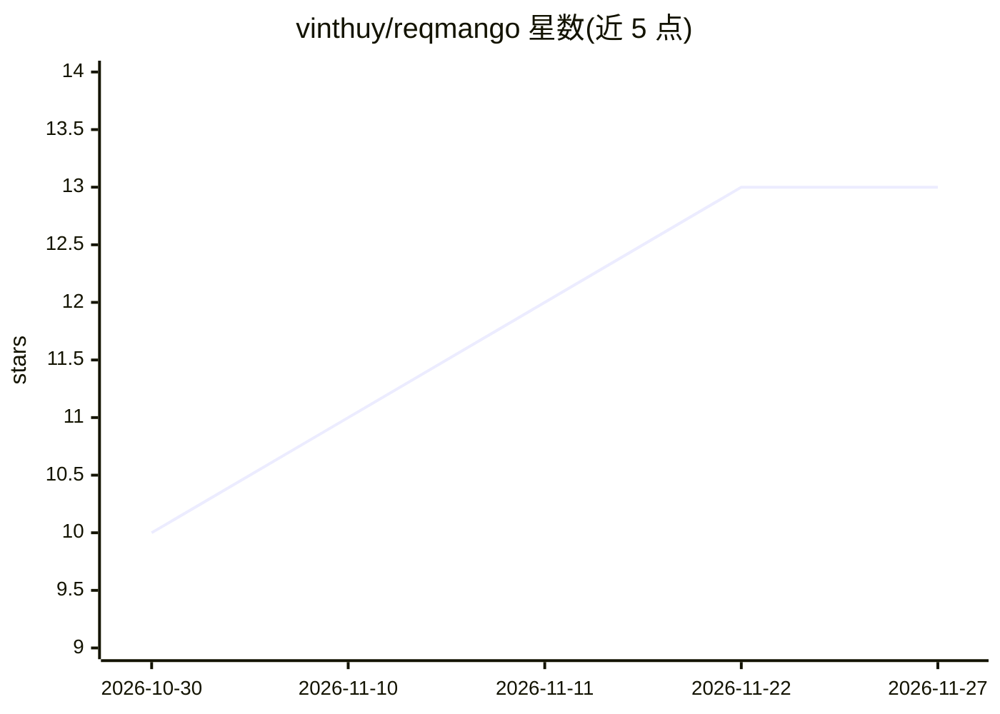

# vinthuy/reqmango

⭐ 13 · Go · MIT · 推送 2026-11-23 · [GitHub](https://github.com/vinthuy/reqmango) · [官网](https://vinthuy.github.io/reqmango/) · 个人维护 · 中文 README

**自托管项目管理工具：请求先分诊再入积压，AI 辅助处理**

自托管的项目管理系统，核心流程是请求先进入 Intake 表单与分诊队列（accept/reject），只有不确定的条目才进入积压；随后提供 Issue（列表/看板/树/日历/甘特）、Cycle、分析、多项目工作区等功能。AI 作为项目管理的附加层提供 Intake 分诊、issue 分析、标签建议、冲刺摘要与 Ask/Build Copilot（写入前预览），需在 .env 中配置 AI_API_KEY 才启用，数据保留在本机。技术栈为 Go + Gin + GORM 后端、Vue 3 + TypeScript 前端、PostgreSQL，推荐 Docker Compose 部署，也支持本地开发方式运行。

## 筛选速览

| 维度 | 判定 | 备注 |
|---|---|---|
| AI 角色 | `ai-enhanced` | 去掉 AI 部分产品仍成立 |
| 许可风险 | `permissive` | MIT |
| 部署形态 | `self-host` | docker 或自建部署 |
| 模型依赖 | — | README 未给出锁定关系 |
| 硬件要求 | — | 无带数字的原话,不猜 |
| 安装摩擦 | `low` | 无编译、无系统依赖或容器化 |
| 成熟度 | — | 结构信号不足 |

## 能力要点

- Intake 表单收集请求并生成去重/优先级提示，人工只裁决不确定项
- AI 辅助 Intake 分诊、issue 分析、标签建议、冲刺摘要与 Build Copilot（写入前预览）
- Issue 列表/看板/树/日历/甘特共享同一过滤器，层级最深 6 级
- 100+ REST 端点，JWT + RBAC，支持中文/英文界面切换

## 适用场景

- 团队在请求进入积压前做统一分诊与去重
- 自托管管理多项目的 issue、冲刺与工作负载分析
- 无账号成员通过公开 Intake 链接提交请求
- 在本地环境用 AI 辅助整理 issue 标签与摘要

## 场景标签

`工作流自动化` `AI 助手` · 领域:效率与自动化

## 证据(README 行号)

> L8: **Self-hosted project management where new requests are triaged first.**
> L58: |**AI in the work loop**|Intake triage, issue analyze, label suggestions, Cycle / sprint summary, Ask / Build Copil
> L66: AI is a layer on top of project management — not a separate “agent IDE” as the default story. Advanced Agent consol

## 星数曲线

2026-10-30 10 → 2026-11-27 13（+3）

---
*卡片 v1 · prompt 1.4 · 生成 2026-11-18 · 置信度 high · 依据 README sha `0b5e2e2f2b8b` · [字段定义](../../DATASET.md)*
