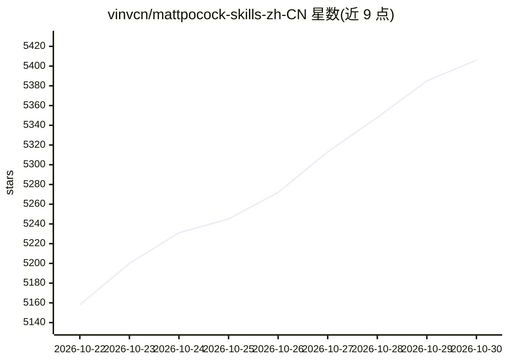

# vinvcn/mattpocock-skills-zh-CN

⭐ 5,406 · JavaScript · MIT · 推送 2026-10-28 · [GitHub](https://github.com/vinvcn/mattpocock-skills-zh-CN) · [官网](https://skills.sh/vinvcn/mattpocock-skills-zh-CN) · 个人维护 · 中文 README

**Matt Pocock coding agent skills 的简体中文本地化仓库**

对上游 mattpocock/skills 的第三方简体中文翻译仓库：仅翻译自然语言说明，保留目录名、技能名、命令、代码块与路径以维持安装运行行为。内容由 Codex 执行同步翻译，人工审核每次更新后经 PR 纳入 main。收录面向 coding agent 的工程与效率技能集（grilling 访谈、TDD、spec 拆票、架构改进等），提供 skills.sh 安装器、Claude Code plugin 与 DeepSeek Harness（dsh）插件三条安装路线，dsh 路线可经 /zh-<name> 调用技能。

## 筛选速览

| 维度 | 判定 | 备注 |
|---|---|---|
| AI 角色 | `ai-ecosystem` | LLM/agent 周边工具 |
| 许可风险 | `permissive` | MIT |
| 部署形态 | `library` | 以包/库形式分发 |
| 模型依赖 | locked-api |  |
| 硬件要求 | — | 无带数字的原话,不猜 |
| 安装摩擦 | `low` | 无编译、无系统依赖或容器化 |
| 成熟度 | — | 结构信号不足 |

## 能力要点

- 仅翻译自然语言、保留技术标识的 skill-guided 本地化策略
- 三条安装路线：skills.sh / Claude Code plugin / dsh 插件（/zh-<name> 调用）
- 人工审核每一次同步更新，定期跟踪上游
- 技能覆盖 grilling 访谈、TDD、spec/ticket 拆分、架构扫描等工程实践

## 适用场景

- 中文开发者在 Claude Code/Codex 等 agent 中使用这套工程技能
- 通过 /zh- 前缀在 DeepSeek Harness 中调用中文技能
- 用追问式访谈在开工前与 agent 对齐需求

## 场景标签

`提示工程` · 领域:Agent 开发

## 证据(README 行号)

> L5: Matt Pocock 的 `mattpocock/skills`：第三方简体中文本地化，非官方仓库。这些 agent skills 是他每天用于真实工程工作的，不是 vibe coding：小、易改、可组合，适用于任何模型。
> L7: 本仓库**定期同步上游**，并额外支持 DeepSeek Harness（dsh）插件安装，安装后以 `/zh-<name>` 调用任意技能（上游没有的能力，详见 `dsh-plugin/README.md`）。

## 星数曲线

2026-10-22 5,158 → 2026-10-30 5,406（+248）

---
*卡片 v1 · prompt 1.4 · 生成 2026-10-21 · 置信度 high · 依据 README sha `0cd0ead8d78c` · [字段定义](../../DATASET.md)*
