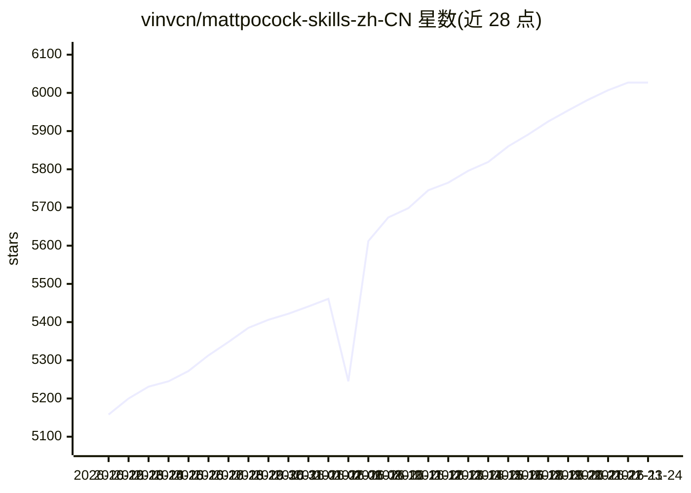

# vinvcn/mattpocock-skills-zh-CN

⭐ 6,060 · JavaScript · MIT · 推送 2026-11-23 · [GitHub](https://github.com/vinvcn/mattpocock-skills-zh-CN) · [官网](https://skills.sh/vinvcn/mattpocock-skills-zh-CN) · 个人维护 · 中文 README

**Matt Pocock 工程技能的简体中文本地化技能集**

将 mattpocock/skills 的 agent 技能文档翻译为简体中文并定期同步上游，同步翻译由 Codex 执行、人工审核后经 PR 合入。翻译只处理自然语言说明，保留目录名、命令、代码块与工具标识以免破坏安装行为。除 skills.sh 复制文件的安装方式外，额外提供 Claude Code、Codex、GitHub Copilot 插件市场安装和 DeepSeek Harness（dsh）插件路线，后者安装后以 /zh-<name> 调用技能。技能按 User-invoked 与 Model-invoked 区分，覆盖工程与通用生产力场景。

## 筛选速览

| 维度 | 判定 | 备注 |
|---|---|---|
| AI 角色 | `ai-knowledge` | 知识聚合/清单类 |
| 许可风险 | `permissive` | MIT |
| 部署形态 | `library` | 以包/库形式分发 |
| 模型依赖 | locked-api |  |
| 硬件要求 | — | 无带数字的原话,不猜 |
| 安装摩擦 | `low` | 无编译、无系统依赖或容器化 |
| 成熟度 | — | 结构信号不足 |

## 能力要点

- 定期同步上游，翻译经人工审核后合入 main
- 额外支持 DeepSeek Harness 插件安装，以 /zh-<name> 调用技能
- 保留目录名、命令、代码块与工具标识的 skill-guided 本地化策略
- 技能分 User-invoked（编排）与 Model-invoked（可复用纪律）两类

## 适用场景

- 为中文母语开发者安装中文说明的 coding agent 技能
- 让以中文语料优化的模型使用中文 prompt 减少歧义
- 在 Claude Code/Codex/Copilot/Gemini CLI 中以插件方式使用工程工作流

## 场景标签

`提示工程` `编码 Agent` · 领域:Agent 开发

## 证据(README 行号)

> L5: Matt Pocock 的 `mattpocock/skills`：第三方简体中文本地化，非官方仓库。这些 agent skills 是他每天用于真实工程工作的，不是 vibe coding：小、易改、可组合，适用于任何模型。
> L44: 翻译策略是 **skill-guided content localization**：把上游 `mattpocock/skills` 当作英文内容来源，只翻译自然语言说明，保留目录名、skill name、frontmatter

## 星数曲线

2026-10-22 5,158 → 2026-11-24 6,027（+869）

---
*卡片 v1 · prompt 1.4 · 生成 2026-11-24 · 置信度 high · 依据 README sha `11effd7aea59` · [字段定义](../../DATASET.md)*
