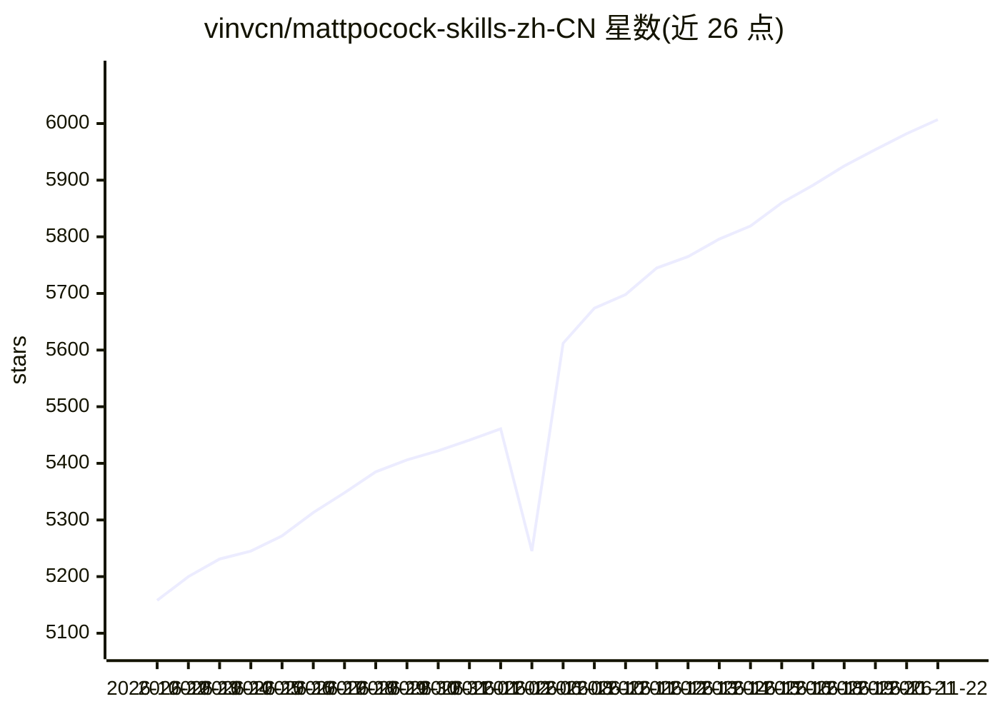

# vinvcn/mattpocock-skills-zh-CN

⭐ 6,007 · JavaScript · MIT · 推送 2026-11-17 · [GitHub](https://github.com/vinvcn/mattpocock-skills-zh-CN) · [官网](https://skills.sh/vinvcn/mattpocock-skills-zh-CN) · 个人维护 · 中文 README

**Matt Pocock 工程 skills 的简体中文本地化仓库，供 coding agents 安装使用**

对上游 mattpocock/skills 的第三方简体中文翻译仓库：采用 skill-guided content localization 策略，只译自然语言说明，保留目录名、命令、代码块、路径与标识符，以免破坏安装运行。同步翻译由 Codex 执行，人工审核后经 PR 纳入 main，定期跟进上游版本。分发上除 skills.sh/npm 与 Claude Code、Codex、GitHub Copilot、Gemini CLI 等官方 plugin 路线外，额外提供上游没有的 DeepSeek Harness（dsh）插件，安装后以 /zh-<name> 调用技能。技能内容覆盖需求对齐（grilling）、TDD、调试、架构改进、issue 拆解等工程流程。

## 筛选速览

| 维度 | 判定 | 备注 |
|---|---|---|
| AI 角色 | `ai-knowledge` | 知识聚合/清单类 |
| 许可风险 | `permissive` | MIT |
| 部署形态 | `library` | 以包/库形式分发 |
| 模型依赖 | locked-api |  |
| 硬件要求 | — | 无带数字的原话,不猜 |
| 安装摩擦 | `low` | 无编译、无系统依赖或容器化 |
| 成熟度 | — | 结构信号不足 |

## 能力要点

- skill-guided content localization：只译说明文本，保留命令与标识符
- 人工审核每次同步更新，定期跟进上游版本
- 额外提供上游没有的 DeepSeek Harness（dsh）插件安装路线
- 38 个技能覆盖 grilling、TDD、调试、架构审查、issue triage 等

## 适用场景

- 让中文母语开发者或中文优化模型以中文 prompt 使用这些工程技能
- 在 coding agent 中建立需求对齐、TDD 与代码审查的工作流
- 多 agent 环境（Claude Code/Codex/Copilot/Gemini CLI）统一安装同一套技能

## 场景标签

`提示工程` `代码审查` `编码 Agent` · 领域:Agent 开发

## 证据(README 行号)

> L5: Matt Pocock 的 `mattpocock/skills`：第三方简体中文本地化，非官方仓库。这些 agent skills 是他每天用于真实工程工作的，不是 vibe coding：小、易改、可组合，适用于任何模型。
> L44: 翻译策略是 **skill-guided content localization**：把上游 `mattpocock/skills` 当作英文内容来源，只翻译自然语言说明，保留目录名、skill name、frontmatter

## 星数曲线

2026-10-22 5,158 → 2026-11-22 6,007（+849）

---
*卡片 v1 · prompt 1.4 · 生成 2026-11-22 · 置信度 high · 依据 README sha `f2eddd63f5bd` · [字段定义](../../DATASET.md)*
