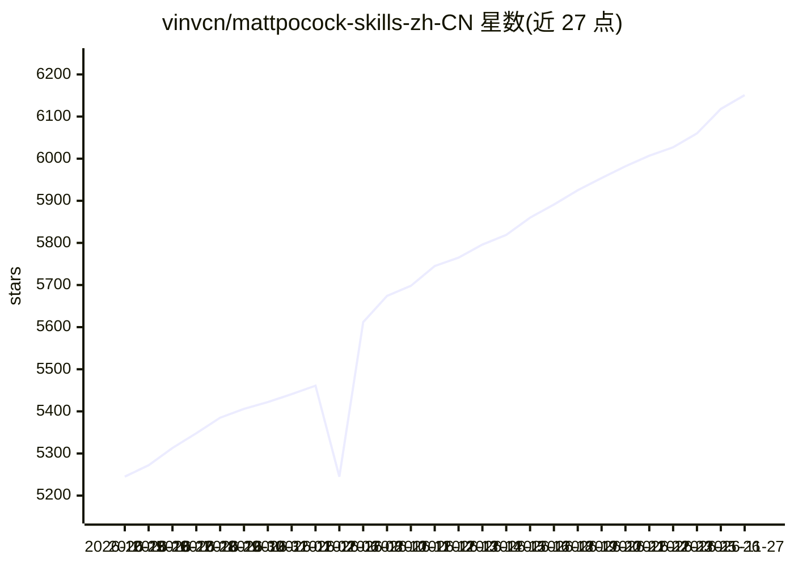

# vinvcn/mattpocock-skills-zh-CN

⭐ 6,151 · JavaScript · MIT · 推送 2026-11-25 · [GitHub](https://github.com/vinvcn/mattpocock-skills-zh-CN) · [官网](https://skills.sh/vinvcn/mattpocock-skills-zh-CN) · 个人维护 · 中文 README

**给中文开发者用的 Matt Pocock agent skills 简体中文本地化**

将上游 mattpocock/skills 的 agent skills 翻译为简体中文的第三方仓库：只翻译自然语言说明，保留目录名、命令、代码块与标识符以免破坏运行行为；定期按内容刷新方式同步上游，翻译由 Codex 执行并经人工审核后以 PR 合入。在 Claude Code、Codex、GitHub Copilot、Gemini CLI 等多个 coding agent 中提供插件或 skills.sh 安装路线，并额外新增 DeepSeek Harness（dsh）插件安装方式，安装后以 /zh-<name> 调用技能。Skills 本身按 user-invoked/model-invoked 分类，覆盖工程与生产力场景。

## 筛选速览

| 维度 | 判定 | 备注 |
|---|---|---|
| AI 角色 | `ai-knowledge` | 知识聚合/清单类 |
| 许可风险 | `permissive` | MIT |
| 部署形态 | `library` | 以包/库形式分发 |
| 模型依赖 | locked-api |  |
| 硬件要求 | — | 无带数字的原话,不猜 |
| 安装摩擦 | `low` | 无编译、无系统依赖或容器化 |
| 成熟度 | — | 结构信号不足 |

## 能力要点

- 上游 skills 的简体中文本地化，人工审核每次同步更新
- skill-guided 翻译策略：只译自然语言，保留命令与标识符
- 额外提供上游没有的 dsh（DeepSeek Harness）插件安装路线
- 覆盖 Claude Code、Codex、GitHub Copilot、Gemini CLI 等多种 agent 安装方式

## 适用场景

- 为中文母语开发者在 coding agent 中安装中文说明的工程 skills
- 希望中文 prompt 更贴合中文优化模型的交互场景
- 通过 /zh-<name> 在 dsh 中调用本地化技能

## 场景标签

`提示工程` · 领域:Agent 开发

## 证据(README 行号)

> L5: Matt Pocock 的 `mattpocock/skills`：第三方简体中文本地化，非官方仓库。这些 agent skills 是他每天用于真实工程工作的，不是 vibe coding：小、易改、可组合，适用于任何模型。
> L42: 本仓库按内容刷新方式同步上游，不同步上游 Git 历史或仓库管理状态。同步翻译由 Codex 执行，人工审核每一次更新后由维护者通过 PR 纳入 `main`；维护规则见 `.skills/translate-skill/SKIL
> L251: 这些 skills 按一个维度区分：谁能调用它们。**User-invoked** skills 只有在你输入名称时才能触达（例如 `/grill-me`）；它们的工作是编排。**Model-invoked** skills 可

## 星数曲线

2026-10-25 5,245 → 2026-11-27 6,151（+906）

---
*卡片 v1 · prompt 1.4 · 生成 2026-11-26 · 置信度 high · 依据 README sha `06b3895a07db` · [字段定义](../../DATASET.md)*
