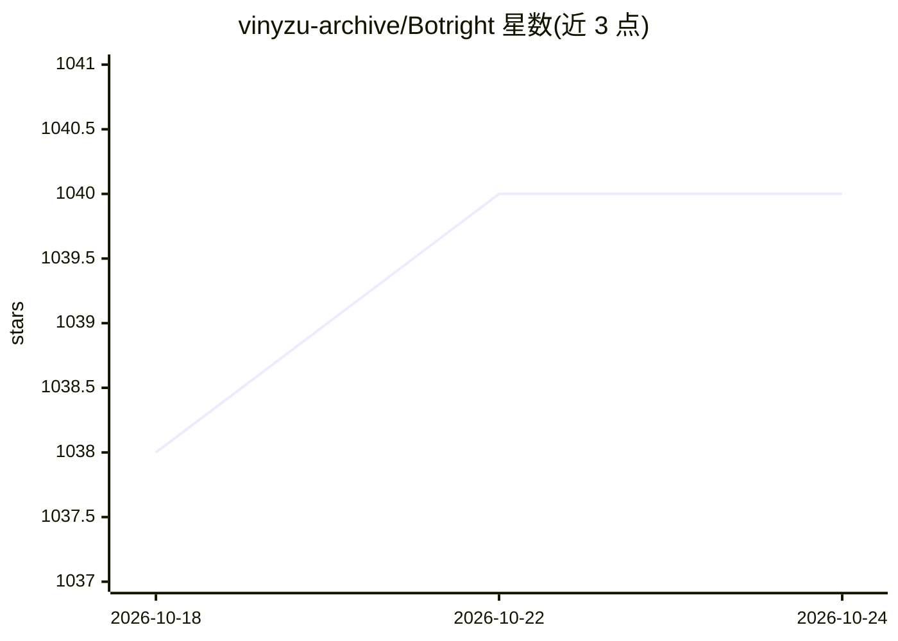

# vinyzu-archive/Botright

⭐ 1,040 · Python · GPL-3.0 · 推送 2026-10-20 · [GitHub](https://github.com/vinyzu-archive/Botright) · 个人维护

**基于 Playwright 的浏览器隐身自动化框架，附带 AI 验证码求解**

构建于 Playwright 之上的 Python 异步自动化框架，核心是浏览器隐身：使用本地 Chromium 内核、自采集的 chrome 指纹伪造浏览器指纹，并附多平台反检测测试成绩表。验证码求解部分使用计算机视觉与 AI 方法（reCognizer、hcaptcha-challenger、cv2.matchTemplate、SSIM、CLIP）求解 reCaptcha/hCaptcha/geeTest v3/v4 等多种验证码，无需付费求解 API。仅支持 async 模式，可与既有 Playwright 代码即插即用。GPL 许可，允许商用但须开放源码。

## 筛选速览

| 维度 | 判定 | 备注 |
|---|---|---|
| AI 角色 | `ai-enhanced` | 去掉 AI 部分产品仍成立 |
| 许可风险 | `viral` | GPL-3.0 |
| 部署形态 | `library` | 以包/库形式分发 |
| 模型依赖 | — | README 未给出锁定关系 |
| 硬件要求 | — | 无带数字的原话,不猜 |
| 安装摩擦 | `low` | 无编译、无系统依赖或容器化 |
| 成熟度 | — | 结构信号不足 |

## 能力要点

- 本地 Chromium + 自采集 chrome 指纹构建伪造浏览器指纹
- 内置反检测测试表（reCaptcha 得分 0.9、CreepJS、DataDome、Cloudflare 等）
- AI/CV 方法求解多种验证码，无需付费求解 API
- 与既有 Playwright 代码即插即用，仅改浏览器初始化

## 适用场景

- 需要在反爬环境下保持隐身的浏览器自动化
- 不依赖第三方付费 API 求解 reCaptcha/geeTest 验证码
- 在现有 Playwright 代码上快速叠加隐身与验证码能力

## 场景标签

`浏览器自动化` · 领域:效率与自动化

## 证据(README 行号)

> L69: Botright uses a vast amount of techniques to hide its functionality as a bot from websites.
> L104: It uses Computer Vision/Artificial Intelligence and other Methods to solve these Captchas.

## 星数曲线

2026-10-18 1,038 → 2026-10-24 1,040（+2）

---
*卡片 v1 · prompt 1.4 · 生成 2026-10-21 · 置信度 high · 依据 README sha `1985cb9ad788` · [字段定义](../../DATASET.md)*
