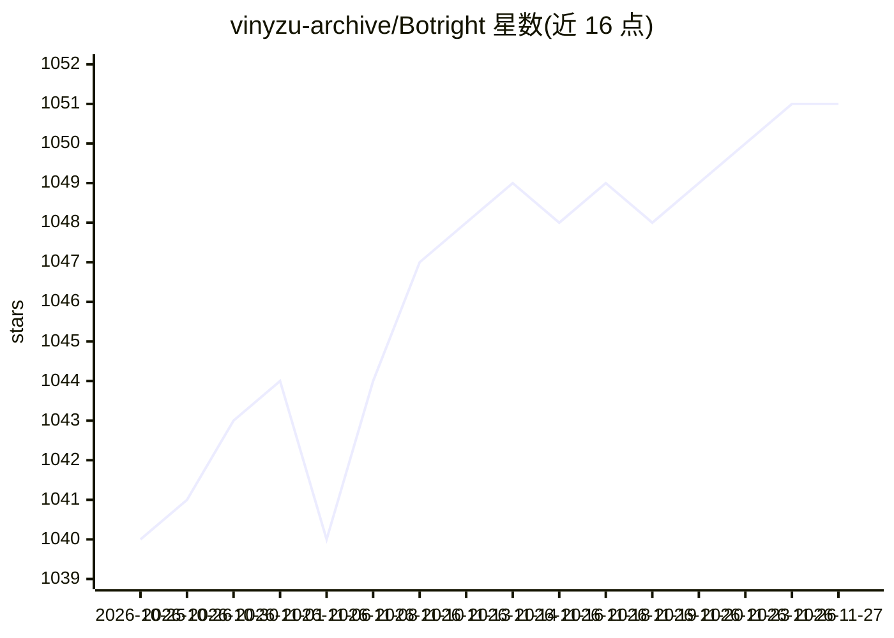

# vinyzu-archive/Botright

⭐ 1,051 · Python · GPL-3.0 · 推送 2026-11-10 · [GitHub](https://github.com/vinyzu-archive/Botright) · 个人维护

**基于 Playwright 的反检测浏览器自动化与免费验证码求解框架**

基于 Playwright 的浏览器自动化框架，当前仅提供 async 模式，可与既有 playwright 代码即插即用，只需替换浏览器初始化。隐身机制包括使用本机真实 Chromium 启动被控浏览器、以自采集 chrome 指纹构造假浏览器指纹；内置免费验证码求解，用计算机视觉/AI 方法（reCognizer、hcaptcha-challenger、CLIP、cv2.matchTemplate 等）处理 reCaptcha、hCaptcha、geeTest v3/v4 等类型。pip 安装，GNU GPL，允许商用但须公开源码与版权。

## 筛选速览

| 维度 | 判定 | 备注 |
|---|---|---|
| AI 角色 | `ai-native` | 本体是模型或模型工具 |
| 许可风险 | `viral` | GPL-3.0 |
| 部署形态 | `library` | 以包/库形式分发 |
| 模型依赖 | — | README 未给出锁定关系 |
| 硬件要求 | — | 无带数字的原话,不猜 |
| 安装摩擦 | `low` | 无编译、无系统依赖或容器化 |
| 成熟度 | — | 结构信号不足 |

## 能力要点

- 与既有 playwright 代码即插即用，仅改浏览器初始化
- 基于本机真实 Chromium 与自采集指纹库做浏览器伪装
- 内置免费验证码求解：reCaptcha、hCaptcha、geeTest v3/v4
- README 附 reCaptcha/CreepJS/Cloudflare/DataDome 等检测测试表

## 适用场景

- 自动化脚本需要通过网站反机器人检测
- 机器人流程中自动求解 reCaptcha、geeTest 等验证码
- 为已有 Playwright 代码增加指纹伪装能力

## 场景标签

`浏览器自动化` · 领域:效率与自动化

## 证据(README 行号)

> L108: It uses Computer Vision/Artificial Intelligence and other Methods to solve these Captchas.
> L110: You dont need to pay for any Captcha Solving APIs and you can solve Captchas with just one simple function call.
> L60: ### It is fully plugable with your existing playwright code. You only have to change your browser initialization!

## 星数曲线

2026-10-25 1,040 → 2026-11-27 1,051（+11）

---
*卡片 v1 · prompt 1.4 · 生成 2026-11-24 · 置信度 mid · 依据 README sha `1170bd4cf653` · [字段定义](../../DATASET.md)*
