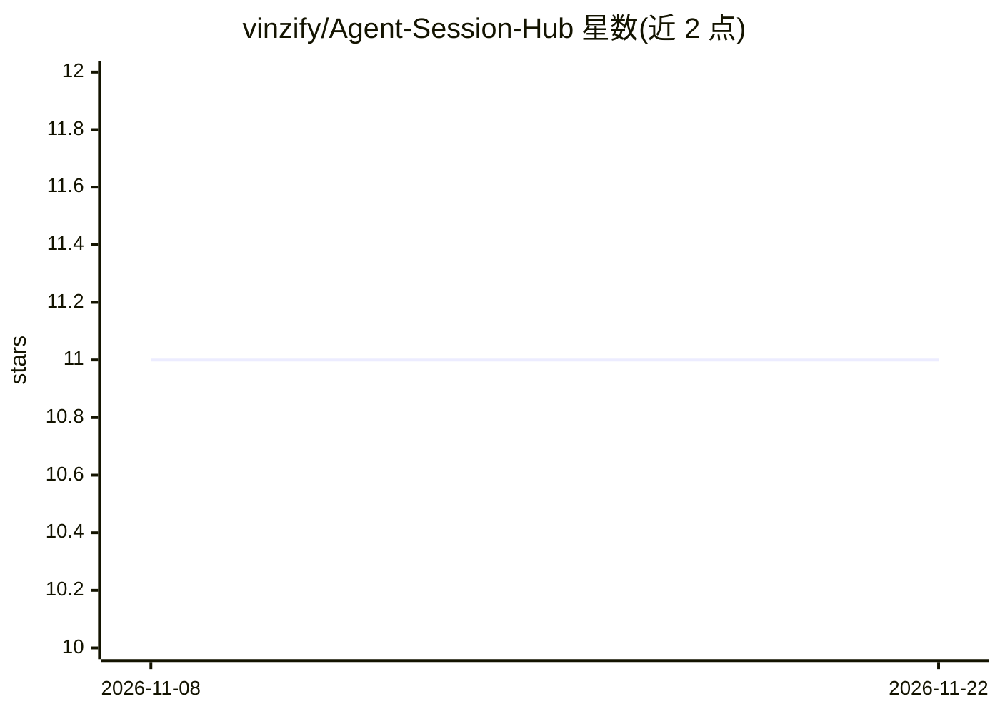

# vinzify/Agent-Session-Hub

⭐ 11 · Rust · MIT · 推送 2026-11-10 · [GitHub](https://github.com/vinzify/Agent-Session-Hub) · 个人维护

**终端里查找、预览并恢复 AI 编码 CLI 会话历史的工具**

Rust 编写的 CLI 工具，面向使用 Codex CLI、Claude Code、OpenCode 和 Google Antigravity CLI 的开发者：将本地会话历史接入 fzf 选择器，按工作区分组，支持搜索（按仓库/分支/标题过滤）、预览对话、回车恢复会话并切换到对应项目目录。另提供会话重命名、按年龄阈值分组清理存储、Claude/Antigravity 的可恢复删除（离线操作+压缩备份）等功能。要求 fzf 0.29+，通过安装脚本提供原生可执行文件。

## 筛选速览

| 维度 | 判定 | 备注 |
|---|---|---|
| AI 角色 | `ai-ecosystem` | LLM/agent 周边工具 |
| 许可风险 | `permissive` | MIT |
| 部署形态 | `None` |  |
| 模型依赖 | — | README 未给出锁定关系 |
| 硬件要求 | — | 无带数字的原话,不猜 |
| 安装摩擦 | `low` | 无编译、无系统依赖或容器化 |
| 成熟度 | — | 结构信号不足 |

## 能力要点

- 支持 Codex CLI、Claude Code、OpenCode、Antigravity 四种 CLI 的会话管理
- fzf 选择器按工作区分组，支持结构化查询（repo:/branch:/title:）
- 基于增量元数据缓存的存储清理，按类别与年龄阈值分组删除
- Claude/Antigravity 删除提供压缩备份与恢复/清除命令

## 适用场景

- 在多个 AI 编码 CLI 之间快速查找并恢复历史会话
- 清理安全扫描等累积的旧会话日志释放存储
- 为 Claude/Antigravity 会话删除保留可恢复备份

## 场景标签

 · 领域:开发者工具/终端效率

## 证据(README 行号)

> L17: Agent Session Hub is a native Rust CLI for **Codex CLI, Claude Code, OpenCode,
> L19: It brings local session history into an `fzf` picker, groups conversations by

## 星数曲线

2026-11-08 11 → 2026-11-22 11（+0）

---
*卡片 v1 · prompt 1.4 · 生成 2026-11-18 · 置信度 high · 依据 README sha `550b47533a73` · [字段定义](../../DATASET.md)*
