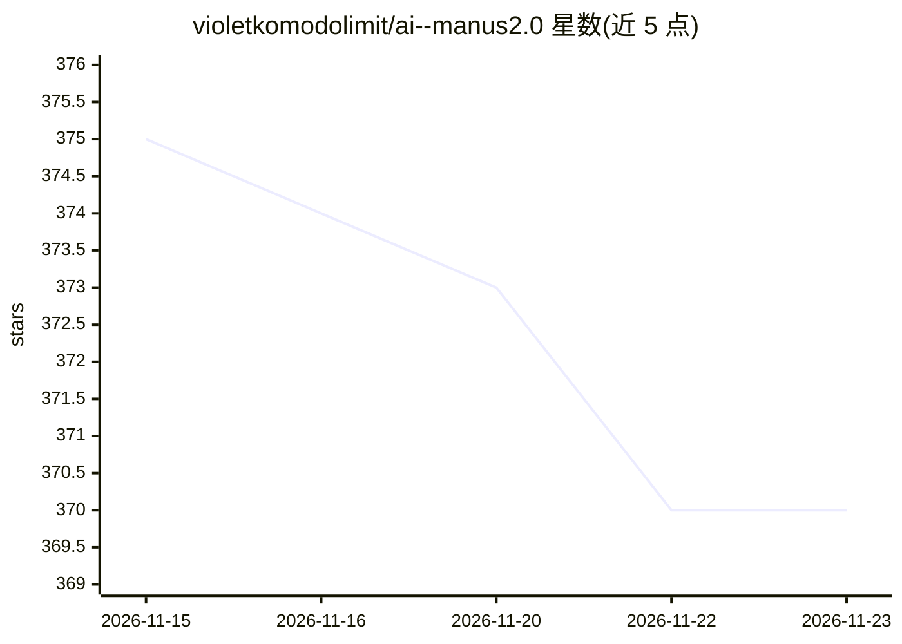

# violetkomodolimit/ai--manus2.0

⭐ 370 · Apache-2.0 · 推送 2026-11-15 · [GitHub](https://github.com/violetkomodolimit/ai--manus2.0) · 个人维护

**面向个人用户的自主 AI Agent：自动执行代码与浏览器操作**

自称 Manus 的自主 AI Agent 系统，宣称可代替用户执行代码、控制浏览器完成多步任务，覆盖日常自动化、研究整理与轻量办公场景。README 为产品介绍性质，未给出安装命令、源码结构或技术实现细节，仅提供硬件兼容表（最低 4GB 内存）与使用步骤说明，并附下载码 PROMO2026。无论文或演示链接，实际运行方式无法从 README 验证。

## 筛选速览

| 维度 | 判定 | 备注 |
|---|---|---|
| AI 角色 | `ai-native` | 本体是模型或模型工具 |
| 许可风险 | `permissive` | Apache-2.0 |
| 部署形态 | `None` |  |
| 模型依赖 | — | README 未给出锁定关系 |
| 硬件要求 | — | 无带数字的原话,不猜 |
| 安装摩擦 | `low` | 无编译、无系统依赖或容器化 |
| 成熟度 | — | 结构信号不足 |

## 能力要点

- 自主执行代码与脚本
- 浏览器控制：导航网页、填表、采集信息
- 代码与浏览器操作可在同一任务流中衔接
- 面向家庭、学习与轻量办公的小规模任务

## 适用场景

- 让 agent 代为完成重复性的代码与浏览器操作
- 整理研究笔记与多页面信息采集
- 日常小任务的后台自动处理

## 场景标签

`浏览器自动化` `编码 Agent` · 领域:效率与自动化

## 证据(README 行号)

> L10: - **Autonomous Code Execution:** Manus AI agent runs code on its own to complete tasks, so you can focus on decisio
> L18: Manus is an autonomous AI agent designed to run code and control a browser on your behalf. Instead of acting like a

## 星数曲线

2026-11-15 375 → 2026-11-23 370（-5）

---
*卡片 v1 · prompt 1.4 · 生成 2026-11-17 · 置信度 low · 依据 README sha `71798a5b9c2b` · [字段定义](../../DATASET.md)*
