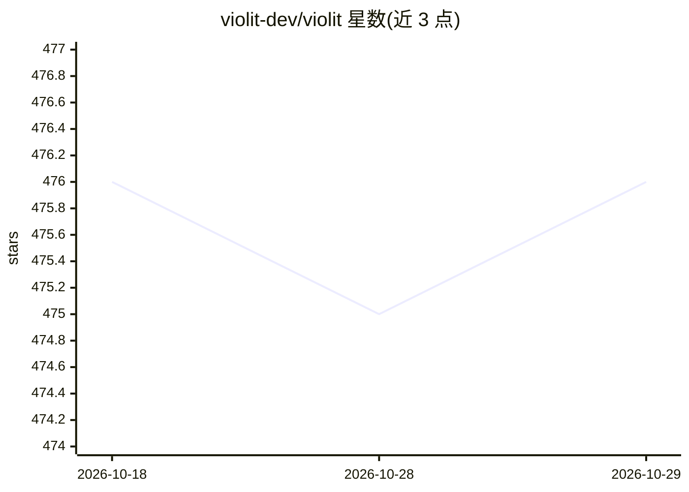

# violit-dev/violit

⭐ 476 · Python · MIT · 推送 2026-06-09 · [GitHub](https://github.com/violit-dev/violit) · [官网](https://violit.cloud) · 组织维护

**纯 Python Web 框架：Streamlit 式写法、无全脚本重跑**

面向从数据应用扩展到通用 Web 应用的 Python 开发者的纯 Python Web 框架。保留 Streamlit 自上而下的脚本式写法，用基于信号的细粒度响应式架构替代全脚本重跑，只更新依赖的组件。内置 ORM（SQLModel+Alembic）、Auth、Tailwind 风格 cls 参数与后台任务/定时任务 API；支持 WebSocket、HTMX Lite、pywebview 桌面三种运行时，后端为 FastAPI/Uvicorn。pip 安装，violit CLI 运行与脚手架建项目，MIT 许可。

## 筛选速览

| 维度 | 判定 | 备注 |
|---|---|---|
| AI 角色 | `ai-ecosystem` | LLM/agent 周边工具 |
| 许可风险 | `permissive` | MIT |
| 部署形态 | `library` | 以包/库形式分发 |
| 模型依赖 | — | README 未给出锁定关系 |
| 硬件要求 | — | 无带数字的原话,不猜 |
| 安装摩擦 | `low` | 无编译、无系统依赖或容器化 |
| 成熟度 | — | 结构信号不足 |

## 能力要点

- 信号驱动的细粒度更新，替代 Streamlit 全脚本重跑
- 内置 ORM/Auth、后台任务 app.background 与定时 app.interval
- 三种运行时：WebSocket / HTMX Lite / pywebview 桌面原生
- violit CLI 提供运行、脚手架与运行时模式切换

## 适用场景

- 构建数据看板与交互式数据应用
- 开发管理后台、内部平台、CRUD 系统
- 把 Streamlit 原型迁移为可扩展的有状态应用
- 用 Python 打包桌面原生应用

## 场景标签

 · 领域:Web 开发框架/数据应用

## 证据(README 行号)

> L9: **Violit** is a Python web framework built on a **fine-grained reactive architecture**. It preserves the highly prod
> L11: It starts naturally from data apps and dashboards, but is not limited to them. With built-in ORM/Auth support and T

## 星数曲线

2026-10-18 476 → 2026-10-29 476（+0）

---
*卡片 v1 · prompt 1.4 · 生成 2026-10-21 · 置信度 mid · 依据 README sha `f4f438c9b368` · [字段定义](../../DATASET.md)*
