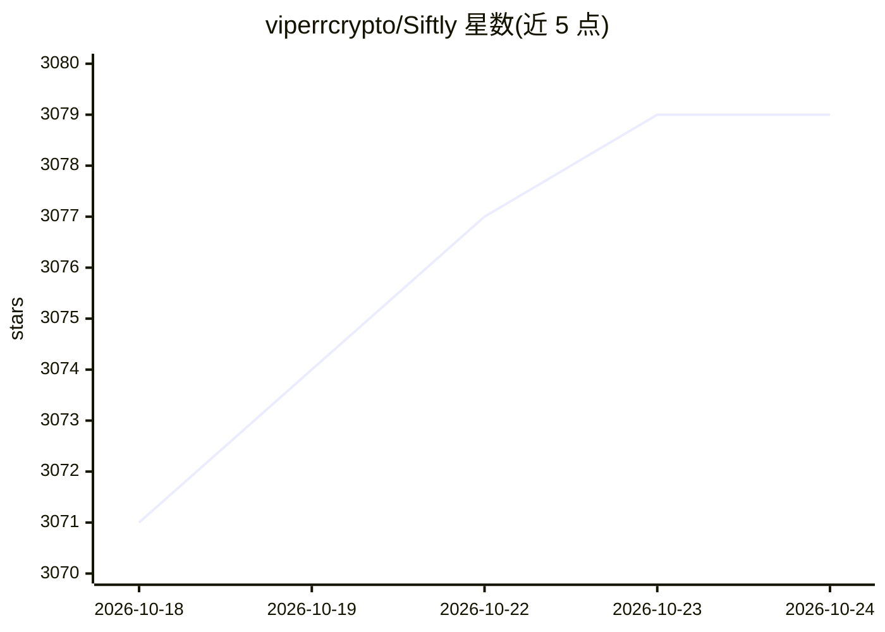

# viperrcrypto/Siftly

⭐ 3,078 · TypeScript · MIT · 推送 2026-04-08 · [GitHub](https://github.com/viperrcrypto/Siftly) · 个人维护

**本地自托管的 Twitter/X 书签管理器，AI 分类与思维导图**

基于 Next.js 16 + TypeScript + SQLite 的自托管 Web 应用：通过书签小程序或控制台脚本导入 X 书签，运行 4 阶段 AI 流水线（实体抽取、视觉分析、语义打标、分类），支持自然语言 AI 搜索、交互式思维导图、筛选浏览与 CSV/JSON/ZIP 导出。AI 能力默认经 Claude Code CLI 会话或 Anthropic API key 调用，也可配置 OpenAI、MiniMax 或任意 Anthropic 兼容端点；数据本地存储，除 AI API 调用外无外部请求。面向个人用户，需 Node.js 18+ 环境自行部署运行。

## 筛选速览

| 维度 | 判定 | 备注 |
|---|---|---|
| AI 角色 | `ai-native` | 本体是模型或模型工具 |
| 许可风险 | `permissive` | MIT |
| 部署形态 | `library` | 以包/库形式分发 |
| 模型依赖 | locked-api |  |
| 硬件要求 | — | 无带数字的原话,不猜 |
| 安装摩擦 | `low` | 无编译、无系统依赖或容器化 |
| 成熟度 | — | 结构信号不足 |

## 能力要点

- 4 阶段 AI 流水线：实体抽取、视觉分析、语义打标、分类，支持断点续跑
- 内置书签小程序与控制台脚本导入，无需浏览器扩展
- FTS5 全文索引 + Claude 语义重排的自然语言搜索
- AI 提供方可切换：Anthropic/OpenAI/MiniMax 及自定义兼容端点

## 适用场景

- 把积累的 X 书签整理成可搜索、可分类的本地知识库
- 用自然语言按语义检索书签内容（含图片 OCR 与视觉标签）
- 通过思维导图可视化浏览全部书签分类结构
- 批量导出书签数据与媒体文件

## 场景标签

`语义搜索` `知识库管理` · 领域:知识与检索

## 证据(README 行号)

> L17: Siftly turns your Twitter/X bookmarks into a **searchable, categorized, visual knowledge base** — running entirely 
> L19: It runs a **4-stage AI pipeline** on your bookmarks:

## 星数曲线

2026-10-18 3,071 → 2026-10-24 3,079（+8）

---
*卡片 v1 · prompt 1.4 · 生成 2026-10-20 · 置信度 high · 依据 README sha `169cffa8c977` · [字段定义](../../DATASET.md)*
