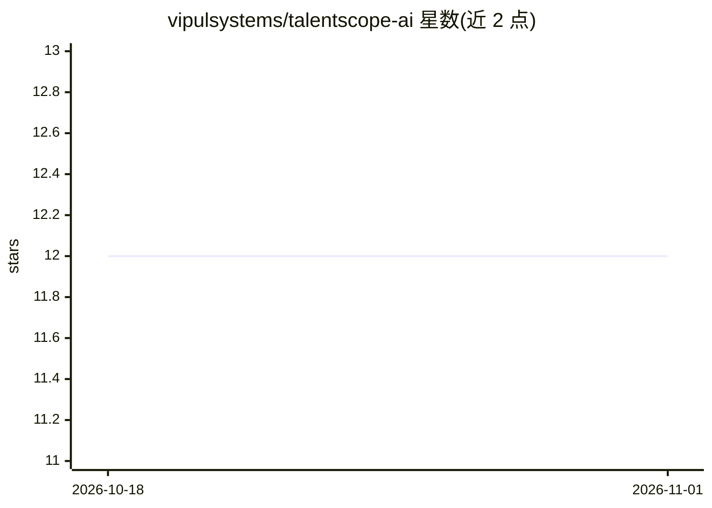

# vipulsystems/talentscope-ai

⭐ 12 · Python · 推送 2026-07-17 · [GitHub](https://github.com/vipulsystems/talentscope-ai) · 个人维护

**AI 面试分析平台：视觉/语音/NLP 评估候选人**

面向招聘方与求职者的全栈面试分析平台：招聘方管理职位、查看分析报告，候选人上传简历、参加视频面试并获得 AI 反馈。分析维度包括 DeepFace 面部情绪检测、Transformers 情感分析、SpeechRecognition 语音转写、Parselmouth 韵律分析与 Scikit-learn 简历匹配，最终输出候选人总分与推荐。技术栈为 React/Flask/MongoDB，需手动分别启动前后端；实时面试（WebRTC）与 Docker 部署列为未来计划。

## 筛选速览

| 维度 | 判定 | 备注 |
|---|---|---|
| AI 角色 | `ai-native` | 本体是模型或模型工具 |
| 许可风险 | `none` | — |
| 部署形态 | `library` | 以包/库形式分发 |
| 模型依赖 | — | README 未给出锁定关系 |
| 硬件要求 | — | 无带数字的原话,不猜 |
| 安装摩擦 | `low` | 无编译、无系统依赖或容器化 |
| 成熟度 | — | 结构信号不足 |

## 能力要点

- DeepFace 面部情绪检测与 Transformers 情感分析
- SpeechRecognition 语音转写与 Parselmouth 韵律分析
- Scikit-learn 简历-职位匹配相似度评分
- 候选人总分与 Strong Fit / Needs Review 推荐

## 适用场景

- 招聘方筛选候选人并查看多维度面试分析报告
- 求职者练习面试并获取 AI 反馈
- 将简历与职位描述做匹配打分

## 场景标签

`语音识别` `人脸识别` · 领域:感知与多模态

## 证据(README 行号)

> L9: TalentScope AI combines **machine learning, NLP, and video analysis** to evaluate candidates across multiple dimensi
> L87: * DeepFace (emotion detection)

## 星数曲线

2026-10-18 12 → 2026-11-01 12（+0）

---
*卡片 v1 · prompt 1.4 · 生成 2026-10-31 · 置信度 high · 依据 README sha `6caf153756ba` · [字段定义](../../DATASET.md)*
