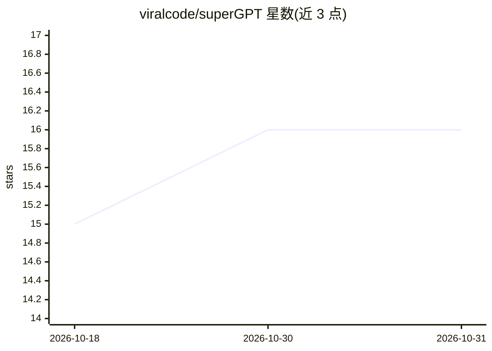

# viralcode/superGPT

⭐ 16 · Python · MIT · 推送 2026-03-27 · [GitHub](https://github.com/viralcode/superGPT) · 个人维护

**从零训练 LLM 的 PyTorch 框架：实现前沿架构特性**

用纯 PyTorch 从零实现 GPT-4 至 DeepSeek V3 等前沿模型主要技术的 LLM 训练框架：覆盖 MLA、GQA、MoE、MTP、YaRN 等架构组件，LoRA/QLoRA 微调、DPO/PPO/GRPO 对齐、知识蒸馏、GGUF 导出、OpenAI 兼容推理服务与 MMLU 等评测。提供 small 到 gpt4/deepseek 共 8 档预设，可从 CPU 笔记本扩展到 GPU 集群。限制：非预训练模型，产出高质量模型需自行提供大规模算力与数据。

## 筛选速览

| 维度 | 判定 | 备注 |
|---|---|---|
| AI 角色 | `ai-ecosystem` | LLM/agent 周边工具 |
| 许可风险 | `permissive` | MIT |
| 部署形态 | `library` | 以包/库形式分发 |
| 模型依赖 | local-ok | 支持本地模型 |
| 硬件要求 | `gpu-8g` | |
| 安装摩擦 | `low` | 无编译、无系统依赖或容器化 |
| 成熟度 | — | 结构信号不足 |

## 能力要点

- 实现 MLA、GQA、DeepSeekMoE、MTP、YaRN 等前沿架构组件
- LoRA/QLoRA 微调与 DPO/PPO/GRPO/RLVR 对齐训练
- GGUF 导出至 llama.cpp/Ollama，OpenAI 兼容推理服务
- 内置 MMLU/HellaSwag/GSM8K 等评测基准

## 适用场景

- 学习和复现前沿 LLM 架构的完整实现
- 在自己的文本数据上从零训练小规模模型
- 在消费级 GPU 上用 QLoRA 微调并对齐模型

## 场景标签

`模型训练` `微调` `强化学习` `模型评测` · 领域:评测与运维

## 证据(README 行号)

> L15: superGPT is a **from-scratch LLM training framework** implementing every major innovation from GPT-4 through DeepSe
> L305: **This isn't**: A pretrained model. The architecture is frontier-level, but producing a ChatGPT-quality model requ

## 星数曲线

2026-10-18 15 → 2026-10-31 16（+1）

---
*卡片 v1 · prompt 1.4 · 生成 2026-10-30 · 置信度 mid · 依据 README sha `fd7f37df99ec` · [字段定义](../../DATASET.md)*
