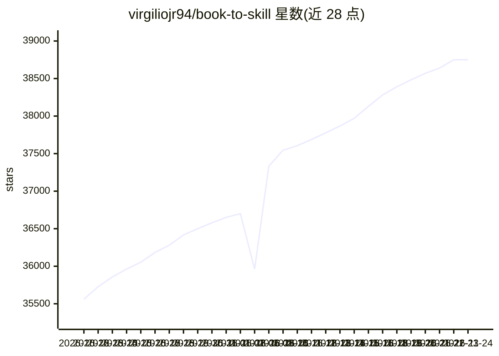

# virgiliojr94/book-to-skill

⭐ 38,873 · Python · MIT · 推送 2026-11-22 · [GitHub](https://github.com/virgiliojr94/book-to-skill) · 个人维护 · 中文 README

**把技术书籍 PDF 转成 agent 可加载的结构化技能**

book-to-skill 是一个文档到 Agent Skill 的转换器：输入本地 PDF/EPUB/DOCX/Markdown 等文件（或经 MCP 远程检索书籍），先由确定性 Python 提取器抽取文本与元数据，再按 SKILL.md 规格生成含章节索引、术语表、模式库与速查表的分层技能，章节文件按需加载以控制 token 消耗。生成的技能可被 GitHub Copilot CLI、Claude Code、Codex 等支持 Agent Skills 标准的宿主读取。面向使用 AI 编码助手的开发者。限制：扫描版 PDF 需先自行 OCR，各格式的提取工具需自行安装。

## 筛选速览

| 维度 | 判定 | 备注 |
|---|---|---|
| AI 角色 | `ai-ecosystem` | LLM/agent 周边工具 |
| 许可风险 | `permissive` | MIT |
| 部署形态 | `library` | 以包/库形式分发 |
| 模型依赖 | — | README 未给出锁定关系 |
| 硬件要求 | — | 无带数字的原话,不猜 |
| 安装摩擦 | `low` | 无编译、无系统依赖或容器化 |
| 成熟度 | — | 结构信号不足 |

## 动量与使用信号

- 维护:`active` — 距上次 push 6.3 天,年发版 5,49 位贡献者
- 涨星:近 1 天 **+125**(自 20261016 起算)
- 安装:pypi 包 `pypdf` 月下载 125,991,621

## 能力要点

- 生成 SKILL.md + 章节文件 + 术语表/模式库/速查表的分层技能结构
- 章节文件按需加载，token 消耗与回答成比例
- 支持本地多格式文件与 MCP 远程搜索（title/author/ISBN/DOI）两种入口
- 生成技能可发布到 GitHub 并经 npx skills add 安装

## 适用场景

- 把常翻的技术书转成 agent 技能，边工作边按章节提问
- 把内部文档/设计规范/论文集合并为一个可查询的技能
- 减少直接把整本书塞进上下文的 token 开销

## 场景标签

`文档解析` · 领域:知识与检索

## 证据(README 行号)

> L10:  Turn any technical book, document folder, or collection of sources into a unified agent skill — ready to study, re
> L93: Two halves: a deterministic Python **extractor** (document → clean text + metadata) and a spec-driven **generator**
> L62: Running `/book-to-skill your-book.pdf` (or a folder, glob, or list of files) creates a full skill in the user-level

## 星数曲线

2026-10-22 35,561 → 2026-11-24 38,750（+3,189）

---
*卡片 v1 · prompt 1.4 · 生成 2026-11-22 · 置信度 low · 依据 README sha `aa910f2e8304` · [字段定义](../../DATASET.md)*
