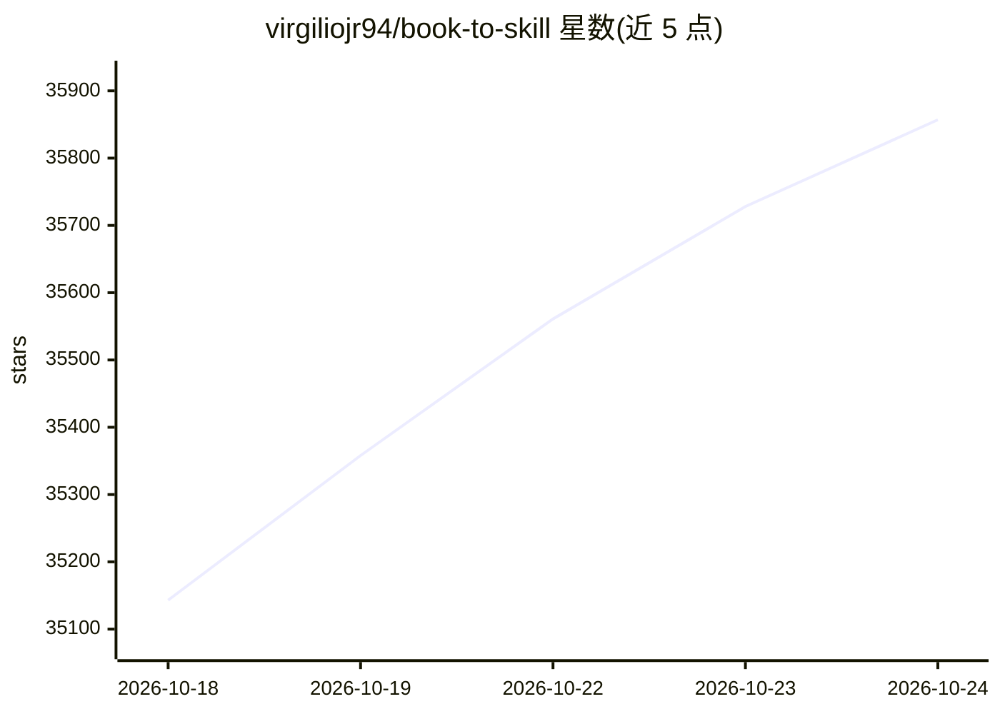

# virgiliojr94/book-to-skill

⭐ 35,857 · Python · MIT · 推送 2026-10-18 · [GitHub](https://github.com/virgiliojr94/book-to-skill) · 个人维护

**把技术书籍 PDF 转成 agent 可用的结构化技能**

以 Agent Skills 标准（SKILL.md）为输出格式的转换器：指向一个 PDF、文件夹或 glob，先由确定性 Python 提取器产出文本与元数据，再由 agent 按 spec 生成含章节索引、词汇表、模式与速查表的结构化技能，章节文件按需加载。兼容 GitHub Copilot CLI、Claude Code、Codex、OpenCode 等多个宿主。MIT 许可，本地处理，不内置任何书籍内容。

## 筛选速览

| 维度 | 判定 | 备注 |
|---|---|---|
| AI 角色 | `ai-ecosystem` | LLM/agent 周边工具 |
| 许可风险 | `permissive` | MIT |
| 部署形态 | `library` | 以包/库形式分发 |
| 模型依赖 | — | README 未给出锁定关系 |
| 硬件要求 | — | 无带数字的原话,不猜 |
| 安装摩擦 | `low` | 无编译、无系统依赖或容器化 |
| 成熟度 | — | 结构信号不足 |

## 动量与使用信号

- 维护:`active` — 距上次 push 6.3 天,年发版 5,49 位贡献者
- 涨星:近 1 天 **+125**(自 20261016 起算)
- 安装:pypi 包 `pypdf` 月下载 125,991,621

## 能力要点

- 输出 SKILL.md + 按需加载的章节文件，节省上下文 token
- 支持 PDF/EPUB/DOCX/HTML 等多种格式，按书类型自动选提取工具
- 本地处理，文件不上传
- 支持 GitHub 发布与 npx skills add 一键安装

## 适用场景

- 把常翻的技术书转成 agent 技能随时提问
- 把团队内部文档/runbook 折叠成可查询技能
- 把论文集与笔记合并为一个可更新的技能

## 场景标签

`知识库管理` `文档解析` · 领域:知识与检索

## 证据(README 行号)

> L9:  Turn any technical book, document folder, or collection of sources into a unified agent skill — ready to study, ref
> L90: Two halves: a deterministic Python **extractor** (document → clean text + metadata) and a spec-driven **generator**
> L59: Running `/book-to-skill your-book.pdf` (or a folder, glob, or list of files) creates a full skill in the user-level

## 星数曲线

2026-10-18 35,143 → 2026-10-24 35,857（+714）

---
*卡片 v1 · prompt 1.4 · 生成 2026-10-18 · 置信度 mid · 依据 README sha `ba84edaf0835` · [字段定义](../../DATASET.md)*
