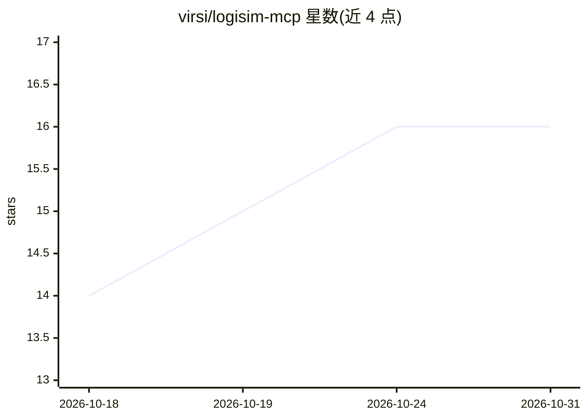

# virsi/logisim-mcp

⭐ 16 · Python · MIT · 推送 2026-05-14 · [GitHub](https://github.com/virsi/logisim-mcp) · 个人维护

**让 LLM 无 GUI 设计与验证 Logisim 数字电路的 MCP 服务器**

面向 Logisim Evolution 4.x 的 stdio MCP 服务器：通过五组工具（IO、低级 Builder、高级 Builder、Simulation、Inspection）让大语言模型直接创建、编辑、仿真和验证 .circ 格式数字电路，含半加器/多路选择器/寄存器等高层构建器和真值表验证。面向做数字逻辑实验的学生配合 AI 助手使用。需 macOS/Linux、Python≥3.10、Java≥17 及 Logisim Evolution JAR。限制：时序电路验证仅对组合电路可靠，真值表综合仅支持积之和形式，不做可视化渲染。

## 筛选速览

| 维度 | 判定 | 备注 |
|---|---|---|
| AI 角色 | `ai-ecosystem` | LLM/agent 周边工具 |
| 许可风险 | `permissive` | MIT |
| 部署形态 | `library` | 以包/库形式分发 |
| 模型依赖 | locked-api |  |
| 硬件要求 | — | 无带数字的原话,不猜 |
| 安装摩擦 | `low` | 无编译、无系统依赖或容器化 |
| 成熟度 | — | 结构信号不足 |

## 能力要点

- 五组 MCP 工具覆盖电路创建、编辑、仿真与检查
- 高层构建器（全加器、多路选择器、译码器、寄存器等）经真值表端到端验证
- XML 解析拒绝 DOCTYPE/ENTITY、25MB 上限、子进程超时钳制等安全措施
- 通过环境变量配置 JAR 路径、超时与语言

## 适用场景

- 用 AI 助手完成数字逻辑实验电路的搭建与验证
- 不打开 GUI 批量生成与仿真 .circ 电路文件
- 按真值表自动合成组合逻辑电路并自检

## 场景标签

 · 领域:EDA/数字逻辑

## 证据(README 行号)

> L19: MCP (Model Context Protocol) server for Logisim Evolution 4.x.
> L20: Lets a large language model design, edit and verify digital circuits in

## 星数曲线

2026-10-18 14 → 2026-10-31 16（+2）

---
*卡片 v1 · prompt 1.4 · 生成 2026-10-30 · 置信度 high · 依据 README sha `d5111fe3c154` · [字段定义](../../DATASET.md)*
