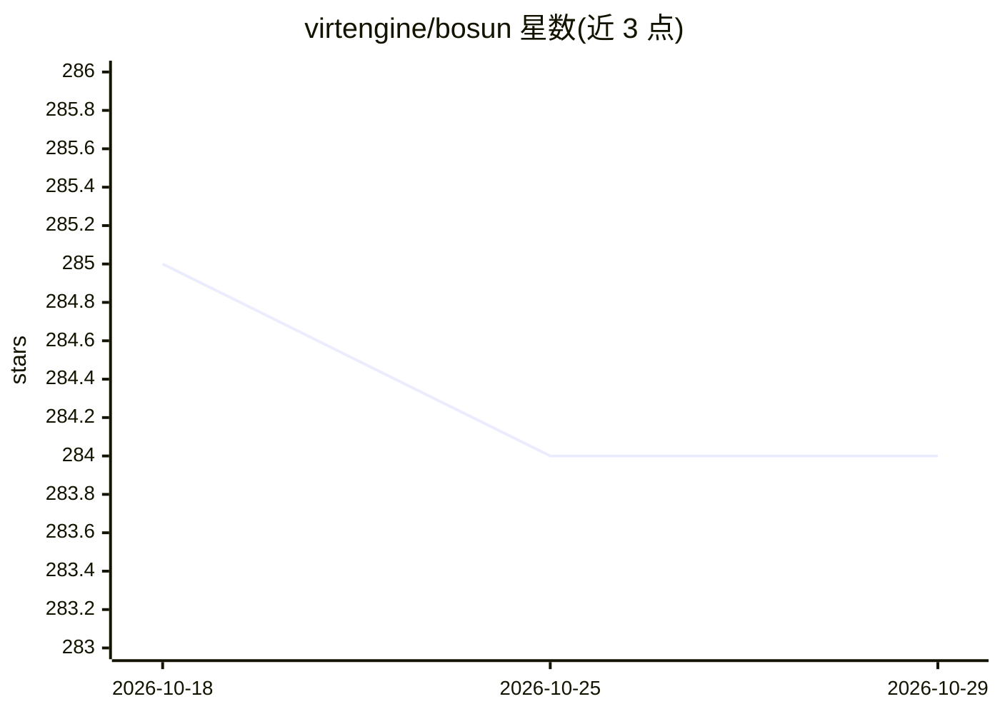

# virtengine/bosun

⭐ 284 · JavaScript · Apache-2.0 · 推送 2026-10-26 · [GitHub](https://github.com/virtengine/bosun) · [官网](https://bosun.engineer) · 组织维护

**自主软件工程师的控制平面：调度多个 AI 执行器完成交付**

面向工程团队的自治软件工程控制平面：将任务规划并分派给 Codex、Copilot、Claude、OpenCode 四类执行器，自动处理重试、故障转移、PR 生命周期（CI 失败自动打标、通过后经审查门自动合并），并将运行持久化到磁盘支持重启恢复。操作者通过 Telegram、Mini App 仪表盘与可选 WhatsApp 通知保持控制，集成 GitHub 与 Jira。提供三种工作流档位（手动/均衡/自治）。安装支持 npm、Docker、源码与 Electron 桌面端，需 Node.js 22.13+ 与 Git。

## 筛选速览

| 维度 | 判定 | 备注 |
|---|---|---|
| AI 角色 | `ai-ecosystem` | LLM/agent 周边工具 |
| 许可风险 | `permissive` | Apache-2.0 |
| 部署形态 | `self-host` | docker 或自建部署 |
| 模型依赖 | locked-api |  |
| 硬件要求 | — | 无带数字的原话,不猜 |
| 安装摩擦 | `low` | 无编译、无系统依赖或容器化 |
| 成熟度 | — | 结构信号不足 |

## 能力要点

- 跨 Codex/Copilot/Claude/OpenCode 四类执行器路由任务并支持重试与故障转移
- PR 生命周期自动化：CI 失败打标 bosun-needs-fix，带审查门的自动合并
- 运行持久化与卡死状态自动恢复、升级
- Telegram 控制、Mini App 仪表盘与 Jira/GitHub 集成

## 适用场景

- 让多个 AI 编码执行器按工作流自动处理 issue 到合并的完整交付环
- 通过 Telegram 远程监控与控制自治工程任务的执行
- 无人值守运行守护进程并自动恢复卡死任务

## 场景标签

`工作流自动化` `编码 Agent` `多智能体` · 领域:Agent 开发

## 证据(README 行号)

> L5: Bosun is a production-grade control plane for an autonomous software engineer. It plans and routes work across execu
> L91: - Routes work across Codex, Copilot, Claude, and OpenCode executors

## 星数曲线

2026-10-18 285 → 2026-10-29 284（-1）

---
*卡片 v1 · prompt 1.4 · 生成 2026-10-22 · 置信度 high · 依据 README sha `88a08900e4a6` · [字段定义](../../DATASET.md)*
