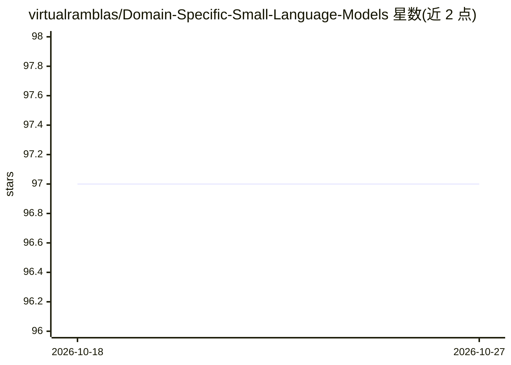

# virtualramblas/Domain-Specific-Small-Language-Models

⭐ 97 · Jupyter Notebook · Apache-2.0 · 推送 2026-08-27 · [GitHub](https://github.com/virtualramblas/Domain-Specific-Small-Language-Models) · 个人维护

**《Domain-Specific Small Language Models》一书配套 Colab 笔记本仓库**

Manning Publications《Domain-Specific Small Language Models》书籍的配套代码仓库，收录与各章节对应的 Colab 笔记本，主题涉及小语言模型、Hugging Face Transformers、PyTorch、量化与优化。所有笔记本草率面向 Colab 免费层设计（部分需要硬件加速），也可在本地 Jupyter、DeepNote、AWS SageMaker 等平台运行，但仓库不提供虚拟环境、依赖包安装与 GPU 驱动配置说明。读者需结合书中章节阅读并运行代码。

## 筛选速览

| 维度 | 判定 | 备注 |
|---|---|---|
| AI 角色 | `ai-knowledge` | 知识聚合/清单类 |
| 许可风险 | `permissive` | Apache-2.0 |
| 部署形态 | `None` |  |
| 模型依赖 | — | README 未给出锁定关系 |
| 硬件要求 | — | 无带数字的原话,不猜 |
| 安装摩擦 | `low` | 无编译、无系统依赖或容器化 |
| 成熟度 | — | 结构信号不足 |

## 能力要点

- 书籍各章节对应的 Colab 笔记本集合
- 全部笔记本设计为可在 Colab 免费层执行
- 主题覆盖小语言模型、Hugging Face Transformers、PyTorch、量化

## 适用场景

- 读者配合书章节边读边跑代码
- 学习领域专用小语言模型的训练与量化
- 在 Colab 免费层实践 LLM 优化技术

## 场景标签

`教程课程` `模型量化` `微调` · 领域:学习与行业

## 证据(README 行号)

> L2: Repository for the companion Colab notebooks of the Domain-Specific Small Language Models book, Manning Publications
> L6: * All the notebooks in this repo have been meant for execution in the Colab free tier (with and without hardware acc

## 星数曲线

2026-10-18 97 → 2026-10-27 97（+0）

---
*卡片 v1 · prompt 1.4 · 生成 2026-10-23 · 置信度 high · 依据 README sha `082e08434a78` · [字段定义](../../DATASET.md)*
