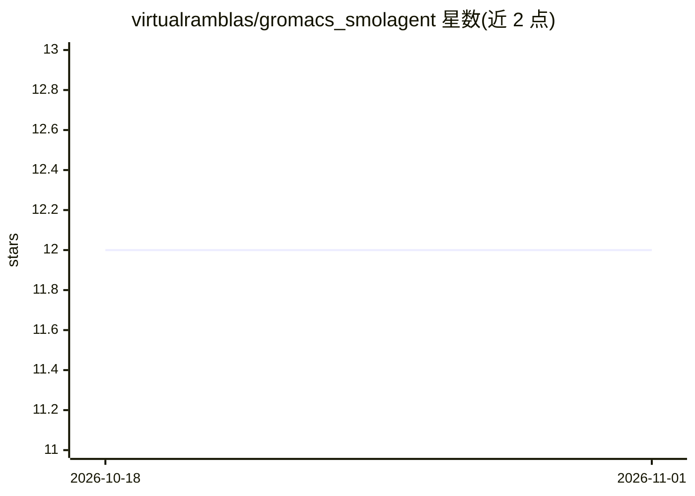

# virtualramblas/gromacs_smolagent

⭐ 12 · Python · Apache-2.0 · 推送 2026-02-05 · [GitHub](https://github.com/virtualramblas/gromacs_smolagent) · 个人维护

**自动化 GROMACS 分子动力学模拟流程的多智能体**

基于 Hugging Face Smolagents 构建的多智能体系统，用开源小语言模型（Qwen 2.5 3B/1.5B Instruct）驱动 GROMACS 分子动力学模拟的自动化：覆盖 PDB 下载与校验、格式转换、体系文件准备、溶剂化、加离子、能量最小化与平衡等步骤，内置 12 个自定义工具。本地模型经 Transformers API（需 NVIDIA GPU 或 Apple Silicon，≥8GB VRAM）或 Ollama 运行。仅支持 Linux/macOS，自述为进行中项目，尚不覆盖 MD 全部阶段；使用 OpenTelemetry/Phoenix 做 agent 运行检视（默认关闭）。

## 筛选速览

| 维度 | 判定 | 备注 |
|---|---|---|
| AI 角色 | `ai-native` | 本体是模型或模型工具 |
| 许可风险 | `permissive` | Apache-2.0 |
| 部署形态 | `None` |  |
| 模型依赖 | local-ok | 支持本地模型 |
| 硬件要求 | `gpu-8g` | |
| 安装摩擦 | `low` | 无编译、无系统依赖或容器化 |
| 成熟度 | `idea` | |

## 能力要点

- 12 个 GROMACS 专用 agent 工具（PDB 转换、溶剂化、能量最小化、平衡等）
- 本地 Qwen 2.5 SLM 驱动，支持 Transformers 与 Ollama 两种加载方式
- 多智能体架构，CLI 入口 gromacs_multi_agent.py
- OpenTelemetry/Phoenix 检视 agent 运行过程

## 适用场景

- 我想让 AI 自动完成从 PDB 文件到 MD 平衡阶段的 GROMACS 流程
- 在本地 GPU 上用小模型跑分子动力学模拟自动化
- 药物发现或材料科学研究中快速搭建 MD 仿真体系

## 场景标签

`多智能体` `科研工具` · 领域:Agent 开发

## 证据(README 行号)

> L24: This repo includes the source code of a concrete example implementation of Agentic AI built on top of a lightweight
> L42: This is still a work in progress and doesn't cover yet all the phases of MD simulations (see the roadmap image belo

## 星数曲线

2026-10-18 12 → 2026-11-01 12（+0）

---
*卡片 v1 · prompt 1.4 · 生成 2026-10-31 · 置信度 high · 依据 README sha `48f8d9f98b03` · [字段定义](../../DATASET.md)*
