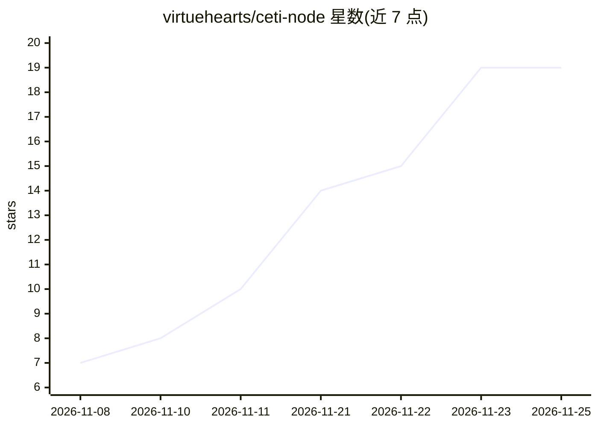

# virtuehearts/ceti-node

⭐ 19 · Python · 推送 2026-11-19 · [GitHub](https://github.com/virtuehearts/ceti-node) · [官网](ceti.darknet.ca) · 个人维护

**本地 P2P 知识节点：从自有本地存储检索作答，不按 token 计费**

以本地为主的知识/聊天节点软件：从 AIML 库、事实库、向量记忆等本地存储检索编译答案，目标是在服务阶段零 token 消耗；模型负责后台研究与提炼。支持聊天、语音、图像、SSH 终端、研究代理等标签页。每个节点是持有公钥的对等端，分享签名事实需对方允许列表；所有写入追加到节点本地的签名哈希链账本。分发形式为 zip 包解压后运行脚本，主要在 Windows + 6GB RTX 显卡上测试。

## 筛选速览

| 维度 | 判定 | 备注 |
|---|---|---|
| AI 角色 | `ai-native` | 本体是模型或模型工具 |
| 许可风险 | `none` | — |
| 部署形态 | `desktop` | 安装包/桌面程序 |
| 模型依赖 | locked-api |  |
| 硬件要求 | — | 无带数字的原话,不猜 |
| 安装摩擦 | `low` | 无编译、无系统依赖或容器化 |
| 成熟度 | `idea` | |

## 能力要点

- 服务阶段纯检索、零 token 的 CETI 会话（答案附层级、推理与签名账本条目）
- 节点间通过公钥签名共享事实，无中心平台
- 每次写入生成签名哈希链账本事件，可用包内密钥本地验证
- 模型中心从 Hugging Face 集合下载 GGUF，也可自行放入模型文件

## 适用场景

- 在本地运行不受审查模型的聊天/语音/图像服务
- 在可信节点之间共享经签名验证的知识与文件
- 用本地研究代理提炼网页内容并经人工批准入库

## 场景标签

`聊天机器人` `RAG` · 领域:对话与助手

## 证据(README 行号)

> L14: CETI is a new type of brain: a local brain that answers from what
> L91: - **Chat** — everyday talk with a local uncensored model, or a
> L100: - **Node network (Gopher, not a platform)** — announce your node

## 星数曲线

2026-11-08 7 → 2026-11-25 19（+12）

---
*卡片 v1 · prompt 1.4 · 生成 2026-11-19 · 置信度 mid · 依据 README sha `51edbb585876` · [字段定义](../../DATASET.md)*
