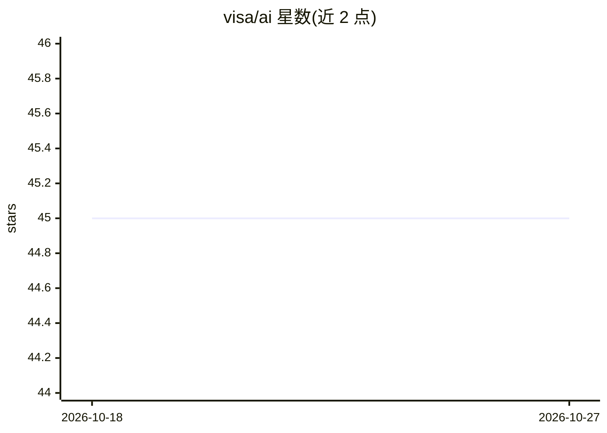

# visa/ai

⭐ 45 · TypeScript · MIT · 推送 2026-09-30 · [GitHub](https://github.com/visa/ai) · [官网](https://developer.visa.com/capabilities/visa-intelligent-commerce) · 组织维护

**连接 AI agent 与 Visa 智能商务平台的集成工具包**

Visa 官方维护的 AI 集成工具仓库：提供用于 Visa API 接入的可复用 npm 包（token 管理、MCP 客户端、API 客户端，含 X-Pay 认证与 MLE 加密）、MCP/REST 客户端示例、基于 LangGraphJS + Next.js 的 AI agent 演示（VTS 卡令牌化与 Visa Passkey）、面向 Claude Code 的技能目录，以及 Gemini CLI 扩展。另提供文档 MCP Server 沙箱端点，供 AI agent 获取 Visa API 集成指南与工具定义。面向在 Visa 开发者平台上构建 AI 体验的开发者，构建采用 npm workspaces + Turbo。

## 筛选速览

| 维度 | 判定 | 备注 |
|---|---|---|
| AI 角色 | `ai-ecosystem` | LLM/agent 周边工具 |
| 许可风险 | `permissive` | MIT |
| 部署形态 | `library` | 以包/库形式分发 |
| 模型依赖 | — | README 未给出锁定关系 |
| 硬件要求 | — | 无带数字的原话,不猜 |
| 安装摩擦 | `low` | 无编译、无系统依赖或容器化 |
| 成熟度 | — | 结构信号不足 |

## 能力要点

- @visa 系列 npm 包：JWE token 管理、MCP 客户端、X-Pay 认证与 MLE 加密 API 客户端
- LangGraphJS + Next.js 的 AI agent 演示：VTS 卡令牌化与 Visa Passkey
- Claude Code 技能目录与 Gemini CLI 扩展
- 文档 MCP Server（sandbox.mcp.visa.com）提供集成指南与工具定义

## 适用场景

- 为 AI agent 接入 Visa 智能商务（VIC）的浏览与支付能力
- 通过 MCP 或 REST 示例学习 Visa API 的认证与加密集成
- 用 Claude Code 技能获取 Visa 开发平台的最佳实践指引

## 场景标签

 · 领域:金融支付/AI 集成

## 证据(README 行号)

> L3: AI tools, examples, and integrations for the Visa Developer Platform. This repository brings together reusable packa
> L20: - **@visa/mcp-client** - MCP client for connecting to Visa MCP server with automatic authentication
> L67: A dedicated MCP server that provides AI agents with integration guides, examples, and tool definitions for Visa API

## 星数曲线

2026-10-18 45 → 2026-10-27 45（+0）

---
*卡片 v1 · prompt 1.4 · 生成 2026-10-25 · 置信度 high · 依据 README sha `2f3c3eb3254a` · [字段定义](../../DATASET.md)*
