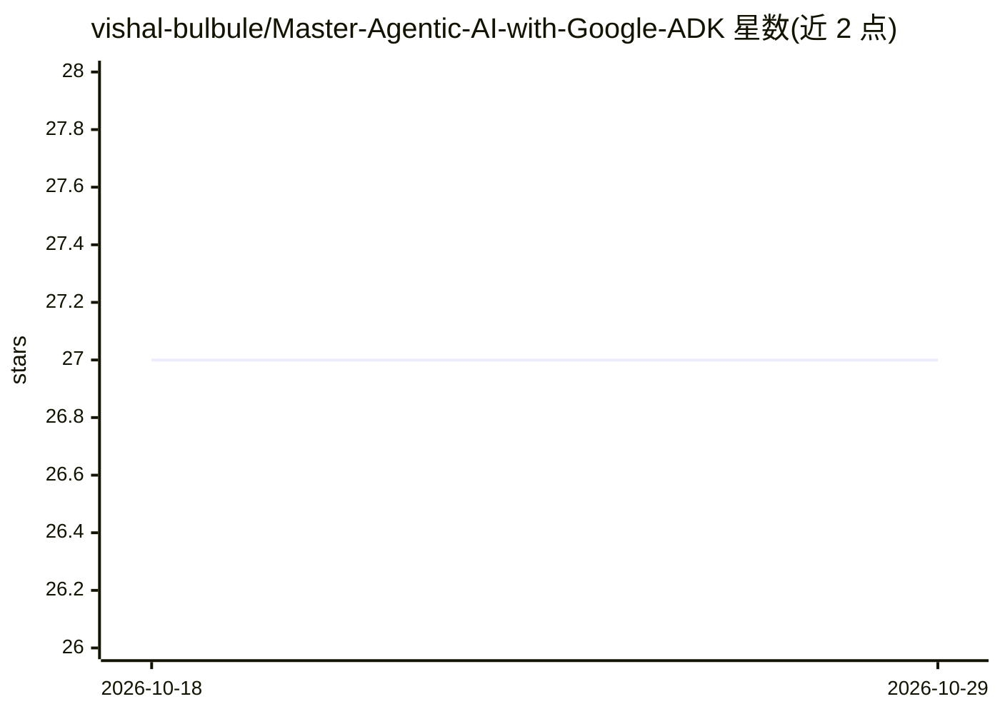

# vishal-bulbule/Master-Agentic-AI-with-Google-ADK

⭐ 27 · Python · Apache-2.0 · 推送 2026-09-26 · [GitHub](https://github.com/vishal-bulbule/Master-Agentic-AI-with-Google-ADK) · 个人维护

**Google ADK 教学：100+ 可运行的 Python agent 代码示例集**

Google Agent Development Kit（ADK）的代码示例仓库，含 100+ 个可直接用 `adk web` 运行的 Python agent，按 16 个模块组织，覆盖工具、MCP 双向、A2A 1.0、Workflow 多 agent 图、回调与护栏、会话/状态/记忆、流式与 Live API 语音、评测（adk eval/rubric）、OpenTelemetry 追踪及 Cloud Run/Agent Runtime 部署。代码在 ADK 2.9.2（Python 3.12）上重建并测试，配套 YouTube 视频讲解，早期版本代码归档于 archived_samples/ 且不再维护。面向学习 Agentic AI 的开发者，部分模块需 Google Cloud 账号、API key 或第三方服务。

## 筛选速览

| 维度 | 判定 | 备注 |
|---|---|---|
| AI 角色 | `ai-knowledge` | 知识聚合/清单类 |
| 许可风险 | `permissive` | Apache-2.0 |
| 部署形态 | `self-host` | docker 或自建部署 |
| 模型依赖 | — | README 未给出锁定关系 |
| 硬件要求 | — | 无带数字的原话,不猜 |
| 安装摩擦 | `low` | 无编译、无系统依赖或容器化 |
| 成熟度 | — | 结构信号不足 |

## 能力要点

- 100+ 个标准 ADK agent 文件夹，统一用 `adk web`/`adk run` 运行
- 16 模块覆盖 MCP、A2A、Workflow、记忆、Live API 语音、评测、部署
- 在 ADK 2.9.2（google-genai 2.24、mcp 2.2、a2a-sdk 1.1）上重建并验证
- 每个主题 README 含 Prerequisites/Run it/Try it/Clean up 结构

## 适用场景

- 系统学习 Google ADK 的 agent 开发全流程
- 查找 MCP 服务器、A2A、多 agent 工作流等具体用法的可运行参考代码
- 跟着配套视频自学费进度学习 Agentic AI

## 场景标签

`教程课程` · 领域:学习与行业

## 证据(README 行号)

> L5: Runnable Python agents for the Google Agent Development Kit: tools, MCP, A2A,
> L116: |#|Module|Agents|What it covers|

## 星数曲线

2026-10-18 27 → 2026-10-29 27（+0）

---
*卡片 v1 · prompt 1.4 · 生成 2026-10-26 · 置信度 mid · 依据 README sha `7054705c00f7` · [字段定义](../../DATASET.md)*
