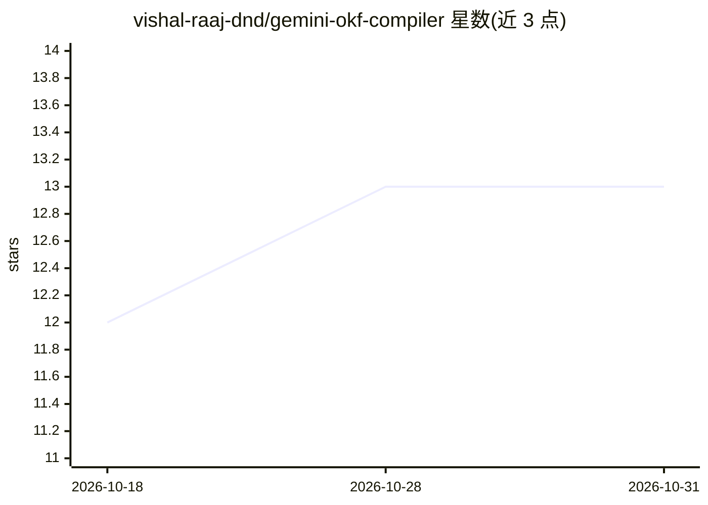

# vishal-raaj-dnd/gemini-okf-compiler

⭐ 13 · Python · MIT · 推送 2026-07-24 · [GitHub](https://github.com/vishal-raaj-dnd/gemini-okf-compiler) · 个人维护

**把企业文档编译为 RAG/Agent 用的跨链接知识图谱**

命令行编译器，将 PDF/DOCX/XLSX/PPTX/HTML/Markdown 文档解析、按标题切分为原子概念文件（200-500 token），经 Gemini Flash 做语义标注后生成带相对 Markdown 链接的零数据库知识图谱（OKF bundle）与根索引 index.md，供 AI Agent 与 RAG 管线按需遍历。提供缓存增量编译与 Mermaid 图谱可视化，支持纯离线的启发式分类模式。安装需 Python 3.9+ 与 Gemini API Key。

## 筛选速览

| 维度 | 判定 | 备注 |
|---|---|---|
| AI 角色 | `ai-ecosystem` | LLM/agent 周边工具 |
| 许可风险 | `permissive` | MIT |
| 部署形态 | `library` | 以包/库形式分发 |
| 模型依赖 | — | README 未给出锁定关系 |
| 硬件要求 | — | 无带数字的原话,不猜 |
| 安装摩擦 | `low` | 无编译、无系统依赖或容器化 |
| 成熟度 | — | 结构信号不足 |

## 能力要点

- 支持 pdf/docx/xlsx/pptx/html/md 六种格式解析与编译
- 原子概念文件切分（200-500 token）与自动跨链接图谱
- 内置启发式分类器可 100% 离线运行，无云端 API 调用
- MD5 哈希缓存实现增量编译，未变更文件零 API 成本

## 适用场景

- 把杂乱的企业文档整理成 RAG 检索用的结构化知识库
- 为 Claude Code 等 agent 准备可遍历的知识图谱目录
- 通过 GitHub Action 在推送时自动编译文档库

## 场景标签

`文档解析` `知识图谱` `RAG` · 领域:知识与检索

## 证据(README 行号)

> L5: > Turn unstructured document mess into clean, semantic, cross-linked Knowledge Graphs designed for AI Agents and RAG
> L7: **OmniOKF** is a high-performance, zero-system-dependency compiler that transforms raw, fragmented enterprise docume
> L9: By utilizing Microsoft's `markitdown` for in-memory document parsing and Gemini Flash for rapid semantic structuring

## 星数曲线

2026-10-18 12 → 2026-10-31 13（+1）

---
*卡片 v1 · prompt 1.4 · 生成 2026-10-31 · 置信度 mid · 依据 README sha `100ecadc3acc` · [字段定义](../../DATASET.md)*
