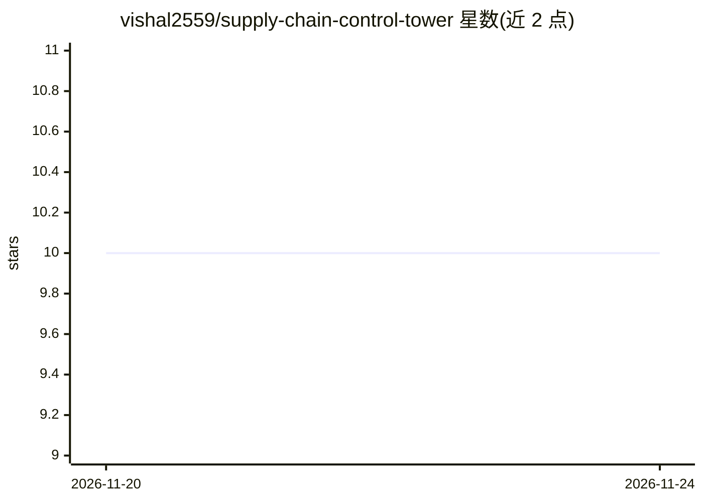

# vishal2559/supply-chain-control-tower

⭐ 10 · Python · MIT · 推送 2026-06-22 · [GitHub](https://github.com/vishal2559/supply-chain-control-tower) · [官网](https://github.com/vishal2559) · 个人维护

**多 Agent 供应链智能系统：自然语言查询运营问题**

基于 Python、FastMCP、SQLite 与 Claude Desktop 的多 Agent 系统社区/演示版：12 个供应链领域 Agent（57 个工具）覆盖发运延迟、库存、采购、货运、仓储、根因调查与持续改进等场景，由 coordinator Agent 将用户自然语言问题路由到相应 Agent，Agent 读取 SQLite 数据并按集中配置的业务规则返回结构化结果。带 Streamlit 仪表盘、只读数据库访问、提示注入防护、缓存与 token 用量跟踪。作者声明用途为学习、作品集与架构演示，范围限于 demo/community 版。

## 筛选速览

| 维度 | 判定 | 备注 |
|---|---|---|
| AI 角色 | `ai-native` | 本体是模型或模型工具 |
| 许可风险 | `permissive` | MIT |
| 部署形态 | `None` |  |
| 模型依赖 | locked-api |  |
| 硬件要求 | — | 无带数字的原话,不猜 |
| 安装摩擦 | `low` | 无编译、无系统依赖或容器化 |
| 成熟度 | — | 结构信号不足 |

## 能力要点

- 12 个供应链领域 MCP Agent，共 57 个工具，coordinator 负责路由
- SQLite 数据层 + 可集中调整的供应链业务规则
- 安全机制：只读数据库访问、输入校验、提示注入防护、工具调用审计日志
- 可选 OpenRouter 作为 LLM fallback，带缓存与 token 跟踪

## 适用场景

- 用自然语言查询订单延迟、库存风险与承运商表现
- 对具体订单做跨领域根因调查
- 参考其架构学习 MCP 多 Agent 系统的搭建方式

## 场景标签

`多智能体` · 领域:Agent 开发

## 证据(README 行号)

> L13: The Supply Chain Control Tower is a public demo/community edition of a multi-agent AI system designed to explore ho
> L15: It connects multiple specialized MCP agents to Claude Desktop, allowing users to ask supply chain questions in plai
> L17: The project demonstrates how AI agents can work together across supply chain domains such as shipment delays, inven

## 星数曲线

2026-11-20 10 → 2026-11-24 10（+0）

---
*卡片 v1 · prompt 1.4 · 生成 2026-11-20 · 置信度 high · 依据 README sha `33f3fd170df7` · [字段定义](../../DATASET.md)*
