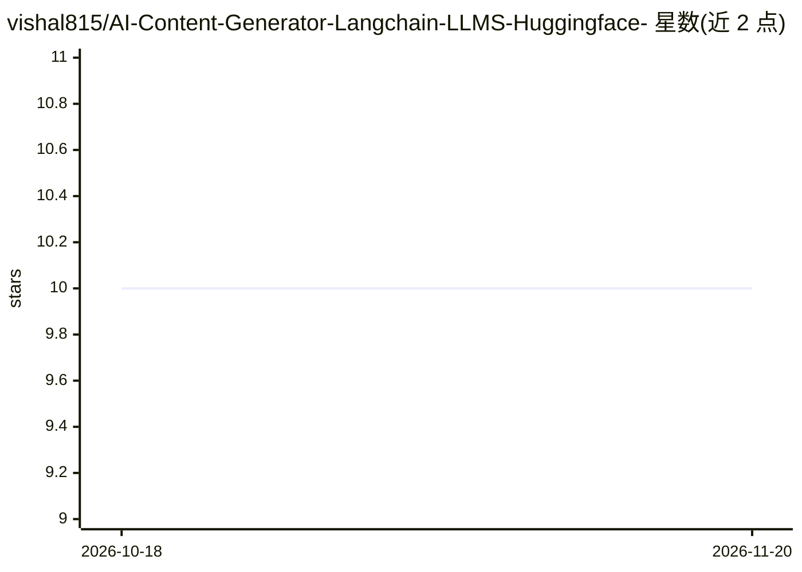

# vishal815/AI-Content-Generator-Langchain-LLMS-Huggingface-

⭐ 10 · Python · 推送 2026-04-22 · [GitHub](https://github.com/vishal815/AI-Content-Generator-Langchain-LLMS-Huggingface-) · [官网](https://huggingface.co/spaces/Visal9252/AI_Content_Generator) · 个人维护

**面向普通用户的 Hugging Face 模型内容生成 Web 应用**

基于 Streamlit 与 LangChain 构建的文本生成 Web 应用，通过 Hugging Face Hub 模型按用户查询生成内容。用户可选择目标年龄组（儿童/成人/老年人）与任务类型（销售文案、推文、产品描述、概念解释），并可设置字数上限；运行需配置 Hugging Face API token，本地以 streamlit run app.py 启动。README 提供实时应用入口但未附具体链接。

## 筛选速览

| 维度 | 判定 | 备注 |
|---|---|---|
| AI 角色 | `ai-native` | 本体是模型或模型工具 |
| 许可风险 | `none` | — |
| 部署形态 | `library` | 以包/库形式分发 |
| 模型依赖 | — | README 未给出锁定关系 |
| 硬件要求 | — | 无带数字的原话,不猜 |
| 安装摩擦 | `low` | 无编译、无系统依赖或容器化 |
| 成熟度 | — | 结构信号不足 |

## 能力要点

- 按年龄组与任务类型定制生成内容
- 可调字数上限的交互式 Streamlit 界面
- 经 LangChain 接口调用 Hugging Face 模型
- 通过 .env 配置 Hugging Face API token 运行

## 适用场景

- 为不同年龄段的受众生成营销文案或推文
- 快速生成产品描述初稿
- 用 LLM 把概念解释改写成适合儿童或老人的表述

## 场景标签

`AI 写作` · 领域:内容生成

## 证据(README 行号)

> L3: This project is an AI-powered content generation tool that leverages Hugging Face's models to create customized cont
> L16: - **Age-Specific Content**: Generate content tailored to Kids, Adults, or Senior Citizens.
> L17: - **Task-Specific Content**: Choose from various tasks like writing a sales copy, creating a tweet, writing a produ

## 星数曲线

2026-10-18 10 → 2026-11-20 10（+0）

---
*卡片 v1 · prompt 1.4 · 生成 2026-11-19 · 置信度 high · 依据 README sha `4b9ea103bb87` · [字段定义](../../DATASET.md)*
