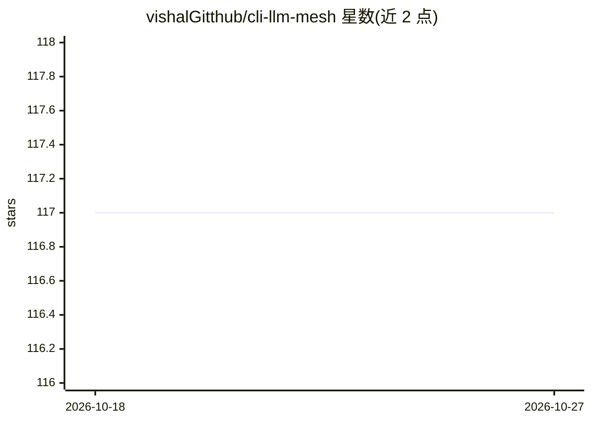

# vishalGitthub/cli-llm-mesh

⭐ 117 · HTML · 推送 2026-10-26 · [GitHub](https://github.com/vishalGitthub/cli-llm-mesh) · 个人维护

**命令行多模型统一网关：xAI/OpenRouter/Mistral/DeepSeek 路由对话**

名为 FirePulse 的终端 AI 网关：通过单一 CLI 接入 xAI、OpenRouter、Mistral、DeepSeek 四类提供方，依据上下文长度、延迟历史与 token 成本在 50ms 内为每次查询选择模型，失败提供方在流中自动替换。API 密钥经 AES-256-GCM 本地加密存储，YAML 配置支持热重载，支持 40+ 语言的输入检测与响应，含 token 用量/延迟/成本实时遥测。要求 Python 3.10+ 与 UTF-8 终端，不托管或修改底层模型。

## 筛选速览

| 维度 | 判定 | 备注 |
|---|---|---|
| AI 角色 | `ai-ecosystem` | LLM/agent 周边工具 |
| 许可风险 | `none` | — |
| 部署形态 | `None` |  |
| 模型依赖 | locked-api |  |
| 硬件要求 | — | 无带数字的原话,不猜 |
| 安装摩擦 | `low` | 无编译、无系统依赖或容器化 |
| 成熟度 | — | 结构信号不足 |

## 能力要点

- 按上下文长度、延迟历史与 token 成本的本地模型路由
- 流式响应与失败提供方流中自动替换（超时>5s 或 HTTP 5xx）
- API 密钥 AES-256-GCM 本地加密，默认不落盘记录查询
- YAML 配置热重载，可在会话中切换提供方

## 适用场景

- 在终端里用单一入口调用多家 LLM 提供方
- 按成本与延迟自动为每条查询选模型
- 跨设备 SSH/WSL 环境下进行多模型对话

## 场景标签

`模型网关` `聊天机器人` · 领域:Agent 开发

## 证据(README 行号)

> L5: ⚡ **Unified AI gateway** connecting xAI, OpenRouter, Mistral, and DeepSeek models through a single, blazing-fast com
> L89: User Query → (Local Router) → Provider A/B/C/D (parallel) → First Response Merger → Stream Output

## 星数曲线

2026-10-18 117 → 2026-10-27 117（+0）

---
*卡片 v1 · prompt 1.4 · 生成 2026-10-23 · 置信度 high · 依据 README sha `ed399bbb1509` · [字段定义](../../DATASET.md)*
