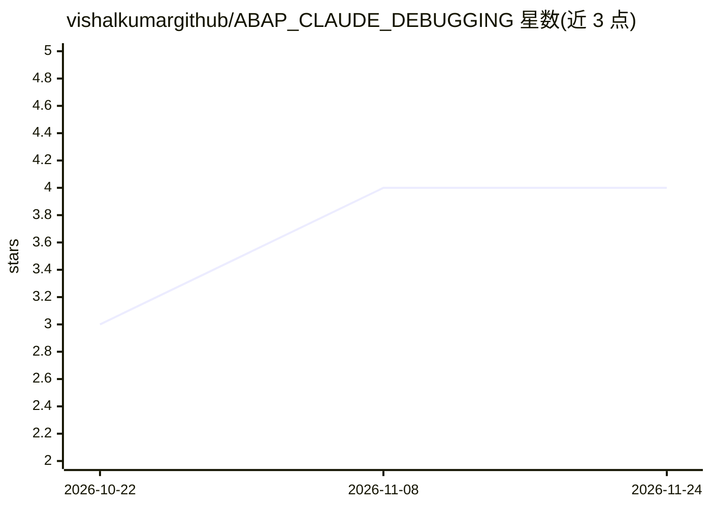

# vishalkumargithub/ABAP_CLAUDE_DEBUGGING

⭐ 4 · ABAP · MIT · 推送 2026-10-08 · [GitHub](https://github.com/vishalkumargithub/ABAP_CLAUDE_DEBUGGING) · 个人维护

**SAP 开发者：把 ABAP 包导出为文本供 Claude 做根因分析**

一个独立的 ABAP 报表程序（ZGCTS_EXPORT），只读运行，将 ABAP 包或传输请求导出为 gCTS 仓库布局的 ZIP 文本（每方法一文件、字典数据为 JSON），供 Claude Code 在导出目录中读取并构建知识图谱（调用关系、表读写、消息与状态含义），按提示词流程追踪事故根因并给出 SE16/SM37/ST22 等系统检查清单。限制包括：输出仅供阅读不可导入、Claude 不读取运行时数据、分享导出前需检查公司源代码政策。

## 筛选速览

| 维度 | 判定 | 备注 |
|---|---|---|
| AI 角色 | `ai-ecosystem` | LLM/agent 周边工具 |
| 许可风险 | `permissive` | MIT |
| 部署形态 | `None` |  |
| 模型依赖 | — | README 未给出锁定关系 |
| 硬件要求 | — | 无带数字的原话,不猜 |
| 安装摩擦 | `low` | 无编译、无系统依赖或容器化 |
| 成熟度 | — | 结构信号不足 |

## 能力要点

- 只读导出 ABAP 包/传输请求为 gCTS 布局的文本 ZIP，不写入 SAP 系统
- 每方法一文件，AI 引用可精确到单个方法
- 配套 CLAUDE.md 模板与 7 步事故分析流程文档
- 跨系统导出可 diff（UTF-8 LF、掩蔽客户端与源系统字段）

## 适用场景

- 把工单症状追溯到 ABAP 代码根因而不逐行断点调试
- 对比 DEV/QA/PROD 的包导出差异
- 让 AI 助手理解包内调用关系、表读写与消息语义

## 场景标签

`知识图谱` · 领域:知识与检索

## 证据(README 行号)

> L5: ZGCTS_EXPORT is one standalone ABAP report. It does not depend on anything else and **never writes to the SAP system
> L14: 2. **Understand.** Claude (Claude Code, started in the repository folder) reads the export once and builds a **know
> L15: 3. **Debug by asking.** For each incident, Claude traces the symptom to its root cause with a file and line for eve

## 星数曲线

2026-10-22 3 → 2026-11-24 4（+1）

---
*卡片 v1 · prompt 1.4 · 生成 2026-11-21 · 置信度 high · 依据 README sha `e46d39d6780a` · [字段定义](../../DATASET.md)*
