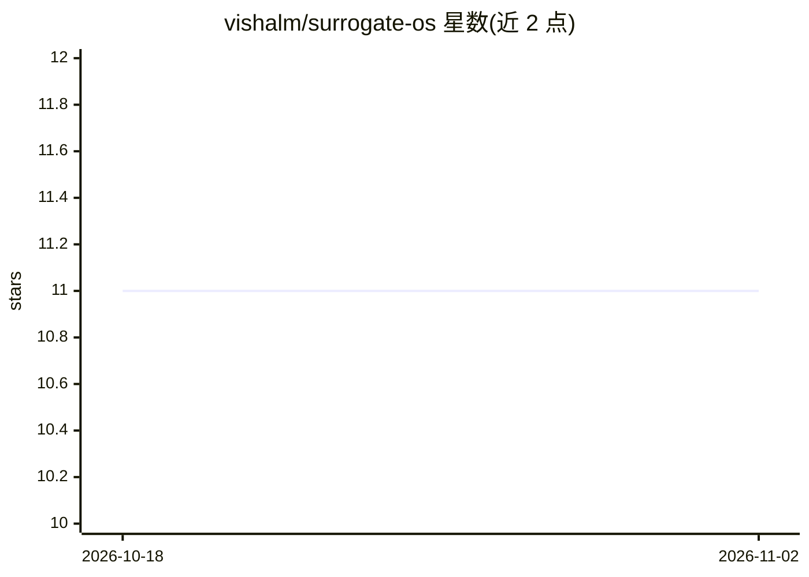

# vishalm/surrogate-os

⭐ 11 · TypeScript · 推送 2026-04-01 · [GitHub](https://github.com/vishalm/surrogate-os) · [官网](https://vishalm.github.io/surrogate-os/) · 个人维护

**从角色描述合成 AI 数字员工的平台，多界面部署**

Surrogate OS 是一个用 TypeScript（Next.js + Fastify）构建的平台：输入角色描述（如资深急诊护士、并购法律顾问）生成具备领域专业知识的 AI 数字员工，包含 LLM 驱动的 SOP 决策图生成、短长期机构记忆、基于 pgvector 的组织知识 RAG 检索。合规方面支持 HIPAA、GDPR、EU AI Act 等 6 套框架，提供 Ed25519 SOP 签名、偏见审计与人工介入控制。支持多租户隔离、车队监控与人形机器人 SDK，可切换 4 种 LLM 后端（含本地 Ollama），通过 Docker Compose（8 容器）部署，需配置 ANTHROPIC_API_KEY 启用 LLM 功能。

## 筛选速览

| 维度 | 判定 | 备注 |
|---|---|---|
| AI 角色 | `ai-native` | 本体是模型或模型工具 |
| 许可风险 | `permissive` | — |
| 部署形态 | `self-host` | docker 或自建部署 |
| 模型依赖 | local-ok | 支持本地模型 |
| 硬件要求 | — | 无带数字的原话,不猜 |
| 安装摩擦 | `low` | 无编译、无系统依赖或容器化 |
| 成熟度 | — | 结构信号不足 |

## 能力要点

- 角色描述生成 AI 数字员工与 SOP 决策图（9 种节点类型）
- 6 套合规框架（HIPAA/GDPR/EU AI Act 等）与 Ed25519 SOP 签名
- 基于 pgvector 的组织知识 RAG 检索与短长期机构记忆
- 4 种 LLM 后端可切换（含本地 Ollama），多租户 schema 隔离

## 适用场景

- 创建具备合规约束的领域专家型 AI 员工用于对话咨询
- 企业以多租户方式管理一批 AI 员工并监控健康状态
- 通过聊天、语音、AR 或人形机器人界面部署同一 AI 员工

## 场景标签

`多智能体` `RAG` · 领域:Agent 开发

## 证据(README 行号)

> L24: Surrogate OS is a platform that creates professional AI surrogates — digital employees with domain expertise, regul
> L97: > Set your `ANTHROPIC_API_KEY` in `infra/.env` to enable LLM features. See the Quick Start Guide for details.

## 星数曲线

2026-10-18 11 → 2026-11-02 11（+0）

---
*卡片 v1 · prompt 1.4 · 生成 2026-11-01 · 置信度 high · 依据 README sha `298d3b7bbdc5` · [字段定义](../../DATASET.md)*
