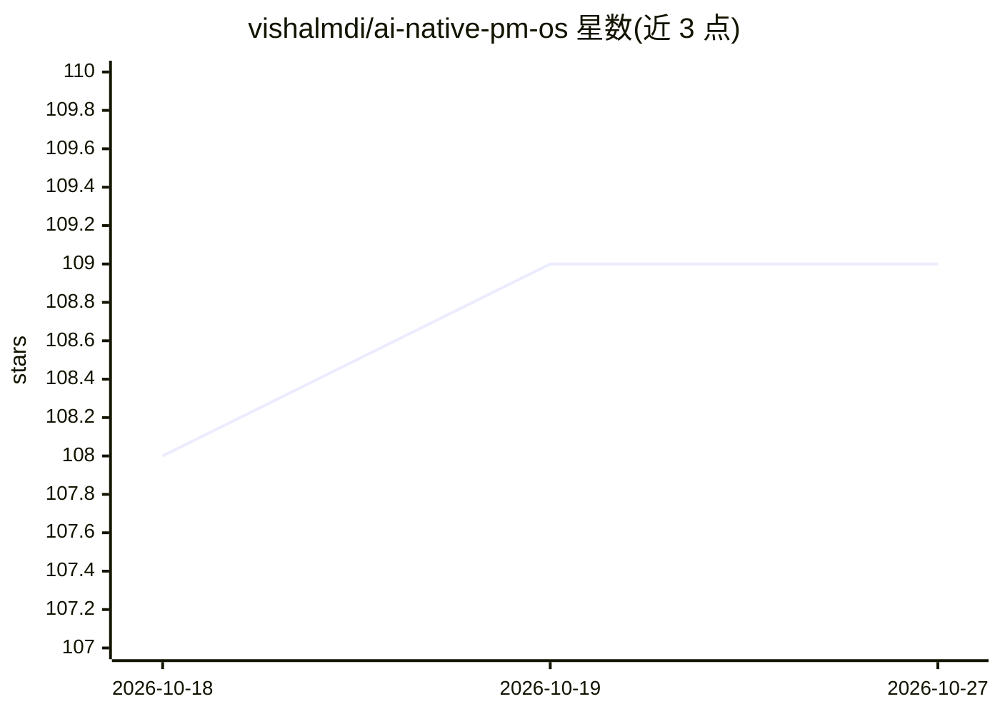

# vishalmdi/ai-native-pm-os

⭐ 109 · Shell · 推送 2026-04-27 · [GitHub](https://github.com/vishalmdi/ai-native-pm-os) · 个人维护

**教产品经理用 Claude Code 搭建个人 PM 工作系统的课程**

面向产品经理的 11 模块交互式课程（约 40–50 小时），内容在 Claude Code 等 AI CLI 环境中进行：通过虚构 B2B SaaS 公司 Meridian 的真实情境，教授 CLAUDE.md 上下文工程、PRD 生成、数据分析、MCP 工具集成等，最终构建多个自动化 PM agent（竞品情报、PRD 转 Jira、客服声音聚类等）。架构以机器可读的 ai-native-pm-os.speq 契约文件为唯一事实源，支持 Claude Code、Codex CLI、Gemini CLI、Aider、Cursor 等多种 agent 运行时，需自备 LLM 订阅或 API key。提供一键 curl 安装脚本与手动 git clone 两种安装方式。

## 筛选速览

| 维度 | 判定 | 备注 |
|---|---|---|
| AI 角色 | `ai-knowledge` | 知识聚合/清单类 |
| 许可风险 | `none` | — |
| 部署形态 | `None` |  |
| 模型依赖 | — | README 未给出锁定关系 |
| 硬件要求 | — | 无带数字的原话,不猜 |
| 安装摩擦 | `low` | 无编译、无系统依赖或容器化 |
| 成熟度 | — | 结构信号不足 |

## 能力要点

- 11 个模块、63 课、约 40–50 小时的交互式课程，以虚构公司 Meridian 为练习情境
- 构建多个自动化 PM agent（竞品情报、PRD-to-Jira、客户声音聚类、原型生成等）
- 以 .speq 机器可读契约封闭世界定义课程架构，约束不同 LLM 的行为漂移
- 五个入口文件（CLAUDE.md/AGENTS.md/GEMINI.md 等）支持多种 AI CLI agent 运行

## 适用场景

- 产品经理系统学习用 Claude Code 完成日常 PM 工作
- 搭建自己的 PRD 生成与研究综合工作流
- 为团队构建自动化 PM agent 与工具集成

## 场景标签

`教程课程` · 领域:学习与行业

## 证据(README 行号)

> L9: Most AI courses teach you to prompt. This course teaches you to **operate**.
> L13: **Format:** Interactive modules inside Claude Code + reference guides + weekly community challenges
> L48: |3|PRDs & Specs|4–5h|Document generation|

## 星数曲线

2026-10-18 108 → 2026-10-27 109（+1）

---
*卡片 v1 · prompt 1.4 · 生成 2026-10-23 · 置信度 high · 依据 README sha `5261e4fc6a71` · [字段定义](../../DATASET.md)*
