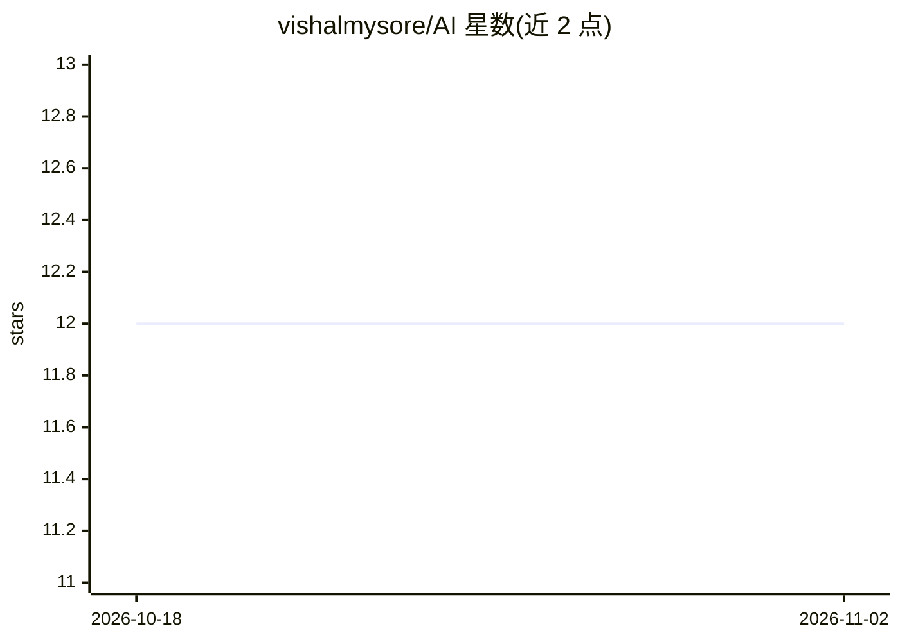

# vishalmysore/AI

⭐ 12 · Jupyter Notebook · 推送 2026-06-24 · [GitHub](https://github.com/vishalmysore/AI) · 个人维护

**AI 实践示例集合：LLM/图像 notebook 教程与集成部署指引**

以 Jupyter notebook 为主的 AI 学习示例仓库（Book Of AI），按 Examples、Integration、Deployments、PromptEngineering、Tools 五部分组织：覆盖 TinyLlama/BERT/Flan-T5/Phi-2 等模型加载与微调、ChromaDB 向量库、SQL 问答、图像生成与识别、模型量化等 30 余个按难度分级的示例；集成部分演示 Langchain、Hugging Face pipeline、LlamaIndex、Haystack 的用法；部署部分列举 GitHub Codespace、RunPod、Vast.ai 等平台。面向动手学习 AI 概念的开发者。

## 筛选速览

| 维度 | 判定 | 备注 |
|---|---|---|
| AI 角色 | `ai-knowledge` | 知识聚合/清单类 |
| 许可风险 | `none` | — |
| 部署形态 | `None` |  |
| 模型依赖 | — | README 未给出锁定关系 |
| 硬件要求 | — | 无带数字的原话,不猜 |
| 安装摩擦 | `low` | 无编译、无系统依赖或容器化 |
| 成熟度 | — | 结构信号不足 |

## 能力要点

- 30 余个按 Beginner/Intermediate/Advanced 分级的 notebook 示例
- 覆盖模型加载、微调、量化、向量数据库、图像生成与识别等主题
- 集成示例涉及 Langchain、Hugging Face pipeline、LlamaIndex、Haystack
- 部署章节列举 Codespace、RunPod、Vast.ai、Together.ai、Paperspace 平台

## 适用场景

- 通过动手 notebook 学习 LLM 与生成式 AI 概念
- 查找向量数据库、模型量化、SQL 问答等具体任务的示例代码
- 了解 LLM 应用的集成框架与部署平台选项

## 场景标签

`教程课程` · 领域:学习与行业

## 证据(README 行号)

> L16: |Example Name|Level|Description|Link|
> L53: Integrade examples with LLM using Langchain, Huggingface pipeline, LamaIndex, or Haystack

## 星数曲线

2026-10-18 12 → 2026-11-02 12（+0）

---
*卡片 v1 · prompt 1.4 · 生成 2026-10-31 · 置信度 high · 依据 README sha `ed669bfdd5a2` · [字段定义](../../DATASET.md)*
