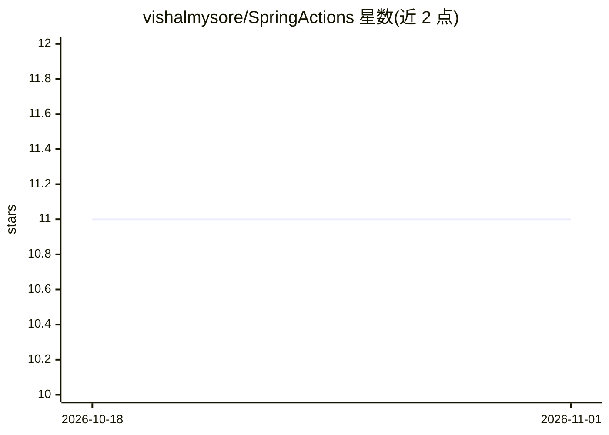

# vishalmysore/SpringActions

⭐ 11 · Java · MIT · 推送 2026-07-29 · [GitHub](https://github.com/vishalmysore/SpringActions) · 个人维护

**将 Spring Bean 自动暴露为 A2A/MCP 工具的 Spring Boot 集成框架**

基于 a2ajava（Google A2A 协议的 Java 实现）将 Spring Boot 应用接入 A2A 协议与 Anthropic MCP。通过 @Agent 与 @Action 注解实现零样板集成，自动发现 Spring Bean 并将其动作暴露为 AI agent 可发现、可调用的 A2A Action 与 MCP 工具，支持基于 prompt 的执行，A2A card 发布于 /.well-known/agent.json。可通过 Claude Desktop 客户端、VS 客户端、A2A 客户端或 curl JSON-RPC 调用工具。面向构建智能微服务的 Java 开发者，使用 Maven 构建与运行。

## 筛选速览

| 维度 | 判定 | 备注 |
|---|---|---|
| AI 角色 | `ai-ecosystem` | LLM/agent 周边工具 |
| 许可风险 | `permissive` | MIT |
| 部署形态 | `None` |  |
| 模型依赖 | — | README 未给出锁定关系 |
| 硬件要求 | — | 无带数字的原话,不猜 |
| 安装摩擦 | `low` | 无编译、无系统依赖或容器化 |
| 成熟度 | — | 结构信号不足 |

## 能力要点

- Spring Bean 自动发现并暴露为 A2A Action 与 MCP 工具
- @Agent/@Action 注解零样板集成，无需额外注解或自定义接线
- 支持基于 prompt 的执行与运行时类型校验
- 可通过 curl JSON-RPC、Claude Desktop 等 REST 方式调用工具

## 适用场景

- 把现有 Spring Boot 微服务开放给 AI agent 调用
- 在 Claude Desktop 中集成 MCP 工具调用 Spring Bean 动作
- 构建可通过 A2A 协议发现的服务端点

## 场景标签

`Agent 框架` · 领域:Agent 开发

## 证据(README 行号)

> L4: Integrate your Spring Boot applications with Google's A2A Protocol and Anthropic's Model Context Protocol (MCP) usin
> L9: This server exposes spring bean actions as A2A and MCP tools, allowing AI agents to discover and interact with them 

## 星数曲线

2026-10-18 11 → 2026-11-01 11（+0）

---
*卡片 v1 · prompt 1.4 · 生成 2026-11-01 · 置信度 high · 依据 README sha `b038210d1b93` · [字段定义](../../DATASET.md)*
