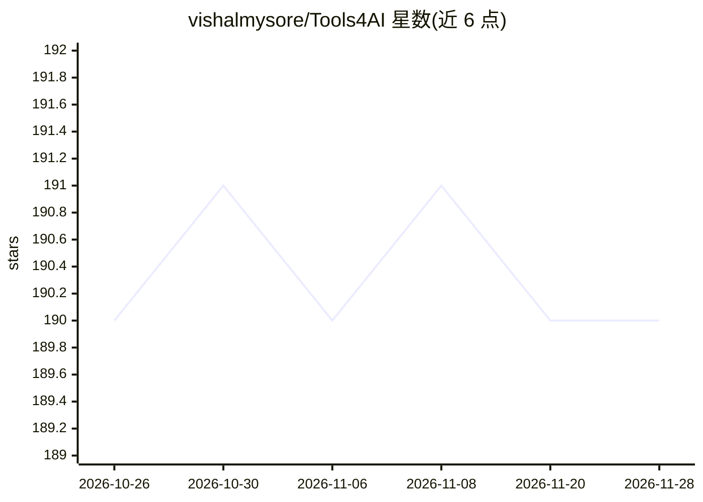

# vishalmysore/Tools4AI

⭐ 190 · Java · MIT · 推送 2026-11-08 · [GitHub](https://github.com/vishalmysore/Tools4AI) · 个人维护

**Java Agentic 框架：将自然语言提示映射为 Java 方法/REST/Shell 动作**

面向 Java 企业的 Agentic 框架：通过注解驱动的类路径扫描与 YAML/JSON 配置，把自然语言提示转换为既有 Java 方法调用、HTTP REST 调用、Swagger/OpenAPI 接口或 Shell 脚本执行，无需 Spring 即可使用。提供 Agent Toolkit 装饰器体系，覆盖记忆（内存/文件持久化）、多 Agent 编排、ReAct 规划、重试与故障转移、令牌桶限流、风险门控人工审批、审计日志与指标观测。定位为对既有 Java 系统做 AI 改造的轻量改造层，单 JAR 发布于 Maven Central。

## 筛选速览

| 维度 | 判定 | 备注 |
|---|---|---|
| AI 角色 | `ai-ecosystem` | LLM/agent 周边工具 |
| 许可风险 | `permissive` | MIT |
| 部署形态 | `None` |  |
| 模型依赖 | local-ok | 支持本地模型 |
| 硬件要求 | — | 无带数字的原话,不猜 |
| 安装摩擦 | `low` | 无编译、无系统依赖或容器化 |
| 成熟度 | — | 结构信号不足 |

## 能力要点

- 提示到动作映射：Java 方法、HTTP REST、Swagger/OpenAPI、Shell 脚本
- Agent Toolkit 装饰器：记忆、编排、ReAct 规划、限流、重试、审计、指标
- 风险分级门控：LOW 直接执行，MEDIUM/HIGH 需人工审批，可配置 fail-closed
- GuardRails、HumanInLoop 及幻觉/偏见/事实检测安全层

## 适用场景

- 让既有 Java 企业应用接受自然语言指令并触发对应业务动作
- 客服场景中由 AI Agent 解析用户请求并调度预约、报销、库存查询等操作
- 对执行高风险动作的 Agent 强制人工审批与审计留痕
- 为多 Agent 系统添加限流、重试与监控能力

## 场景标签

`Agent 框架` `多智能体` · 领域:Agent 开发

## 证据(README 行号)

> L2: Tools4AI is 100% Java based Agentic AI Framework and light weight ADK library which can be used to build Java based 
> L42: Tools4AI is a **retrofit layer** — it makes any existing Java system AI-controllable with minimal code change.

## 星数曲线

2026-10-26 190 → 2026-11-28 190（+0）

---
*卡片 v1 · prompt 1.4 · 生成 2026-11-26 · 置信度 high · 依据 README sha `3cc5797a883e` · [字段定义](../../DATASET.md)*
