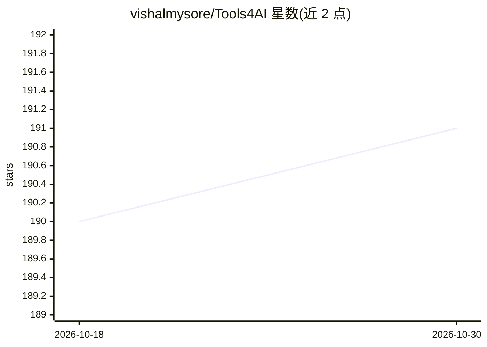

# vishalmysore/Tools4AI

⭐ 191 · Java · MIT · 推送 2026-07-28 · [GitHub](https://github.com/vishalmysore/Tools4AI) · 个人维护

**Java 版 Agentic AI 框架：把自然语言转为 Java 方法/REST/Shell 调用**

100% Java 实现的轻量级 ADK/Agentic 框架，面向企业 Java 应用集成：通过注解扫描既有类/方法，或将自然语言提示路由到 HTTP REST、Java 方法、Shell 脚本与 Swagger API，即所谓 actionble prompts。com.t4a.agent 包以装饰器形式提供记忆、多 agent 编排、ReAct 规划、重试降级、限流、风险审批、审计与指标等组件，支持 OpenAI/Gemini/Anthropic/LocalAI 处理器，无需 Spring。README 含与 Spring AI 的逐项对比表。

## 筛选速览

| 维度 | 判定 | 备注 |
|---|---|---|
| AI 角色 | `ai-ecosystem` | LLM/agent 周边工具 |
| 许可风险 | `permissive` | MIT |
| 部署形态 | `None` |  |
| 模型依赖 | local-ok | 支持本地模型 |
| 硬件要求 | — | 无带数字的原话,不猜 |
| 安装摩擦 | `low` | 无编译、无系统依赖或容器化 |
| 成熟度 | — | 结构信号不足 |

## 能力要点

- 注解驱动的提示到 Java 方法/REST/Shell/Swagger 动作路由
- 装饰器式组件：记忆、多 agent 编排、ReAct 规划、重试与限流
- 风险分级审批（LOW/MEDIUM/HIGH，多级人工确认）与 JSON 审计日志
- 支持 OpenAI、Gemini、Anthropic、LocalAI 多种 AIProcessor

## 适用场景

- 让既有企业 Java 系统通过自然语言被 AI 控制，少改代码
- 为客服、项目管理等场景构建提示触发业务动作的 agent
- 需要人工审批与审计追溯的生产级 agent 部署

## 场景标签

`Agent 框架` `多智能体` · 领域:Agent 开发

## 证据(README 行号)

> L2: Tools4AI is 100% Java based Agentic AI Framework and light weight ADK library which can be used to build Java based 
> L42: Tools4AI is a **retrofit layer** — it makes any existing Java system AI-controllable with minimal code change.

## 星数曲线

2026-10-18 190 → 2026-10-30 191（+1）

---
*卡片 v1 · prompt 1.4 · 生成 2026-10-22 · 置信度 high · 依据 README sha `304739424bf7` · [字段定义](../../DATASET.md)*
