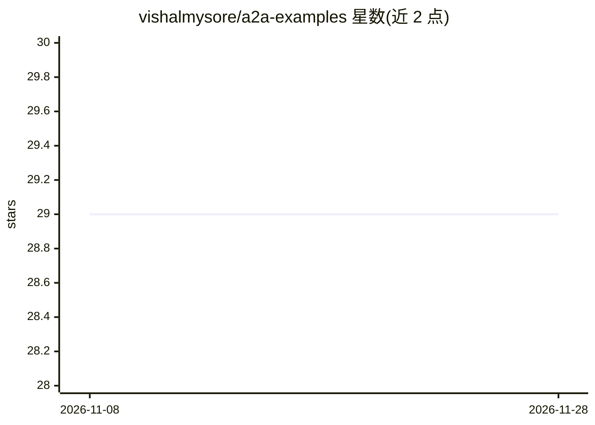

# vishalmysore/a2a-examples

⭐ 29 · Java · MIT · 推送 2026-11-08 · [GitHub](https://github.com/vishalmysore/a2a-examples) · 个人维护

**Java 开发者集成 Google A2A 协议的参考示例集**

提供在 Java 应用中定义与触发 Google A2A（Agent-to-Agent）任务的参考示例，基于 A2AJava 实现：通过 @Agent、@Action 注解把 Java 类和方法暴露为 A2A 兼容 agent，支持结构化提示与自定义 POJO（含嵌套对象）互转及 Spring Boot 集成。示例覆盖 OpenAI/Gemini/Anthropic 的 Action Processor、图像处理、提示转 POJO/JSON/XML、子提示分解、Selenium 与 HTTP/Shell 脚本动作等。通过 git clone 后 mvn clean install 构建，相关构件发布于 Maven Central。

## 筛选速览

| 维度 | 判定 | 备注 |
|---|---|---|
| AI 角色 | `ai-ecosystem` | LLM/agent 周边工具 |
| 许可风险 | `permissive` | MIT |
| 部署形态 | `None` |  |
| 模型依赖 | — | README 未给出锁定关系 |
| 硬件要求 | — | 无带数字的原话,不猜 |
| 安装摩擦 | `low` | 无编译、无系统依赖或容器化 |
| 成熟度 | — | 结构信号不足 |

## 能力要点

- @Agent/@Action 注解将 Java 方法暴露为 A2A 兼容 agent 动作
- 提示与自定义 POJO（含嵌套对象）自动转换，可配自定义 GSON 反序列化
- 示例覆盖 OpenAI/Gemini/Anthropic 处理器、图像处理、子提示依赖分解
- 支持 Spring Boot 集成与英文脚本驱动的自主 agent 执行

## 适用场景

- 用 Java 构建符合 Google A2A 协议的 agent 服务
- 把自然语言提示映射为 Java 方法调用或 POJO/JSON/XML 输出
- 参考多处理器（OpenAI/Gemini/Anthropic）与 Selenium/HTTP 动作集成方式

## 场景标签

`Agent 框架` · 领域:Agent 开发

## 证据(README 行号)

> L3: If you're looking to build Java applications using the Google A2A (Agent-to-Agent) protocol, this repository provide
> L14: Minimal setup: Use simple annotations like @Agent, and @Action to expose your service classes and methods as A2A-co

## 星数曲线

2026-11-08 29 → 2026-11-28 29（+0）

---
*卡片 v1 · prompt 1.4 · 生成 2026-11-18 · 置信度 high · 依据 README sha `8bfb31a72881` · [字段定义](../../DATASET.md)*
