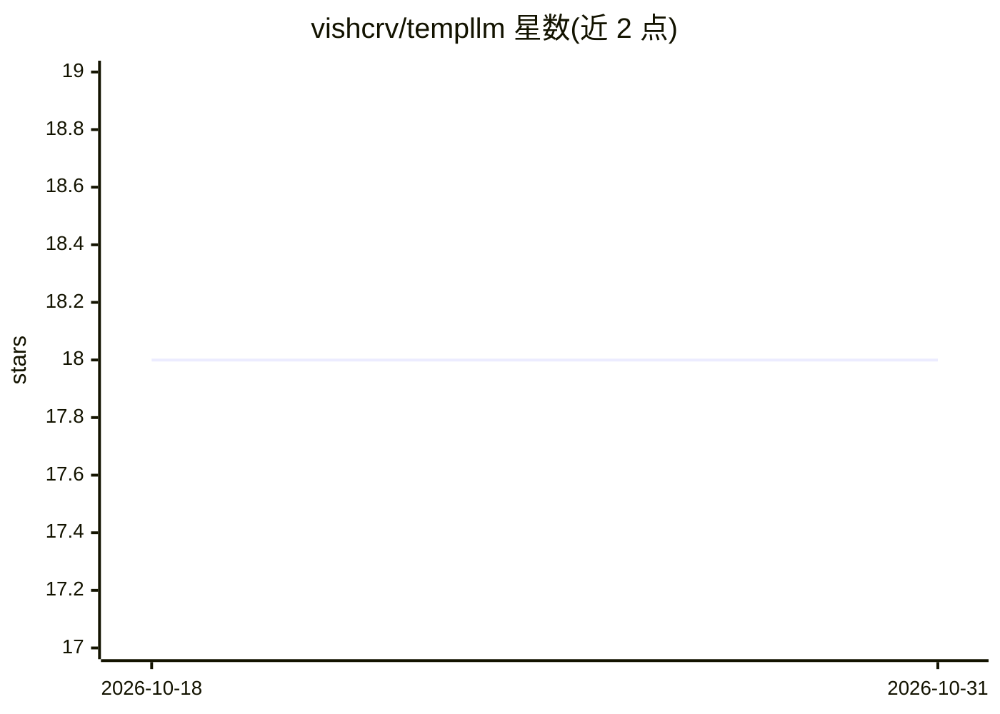

# vishcrv/templlm

⭐ 18 · JavaScript · 推送 2026-04-26 · [GitHub](https://github.com/vishcrv/templlm) · [官网](https://www.npmjs.com/package/templlm) · 个人维护

**把浏览器中的 LLM 聊天页封装成本地 REST API 的工具**

通过 Chrome DevTools Protocol 连接用户已登录的浏览器聊天会话（Playwright 驱动），将提示词转发到网页聊天并暴露为 localhost REST API：提供 /ask、/ask/stream(SSE) 等端点与终端 CLI（含交互式会话）。支持 CDP 附加与无头 Chromium 两种模式，会话可持久化。面向不想申请 API key 的开发者。README 声明仅供教育实验用途，用户需自行遵守各平台服务条款；OpenAI/Anthropic 未关联或背书。

## 筛选速览

| 维度 | 判定 | 备注 |
|---|---|---|
| AI 角色 | `ai-ecosystem` | LLM/agent 周边工具 |
| 许可风险 | `none` | — |
| 部署形态 | `library` | 以包/库形式分发 |
| 模型依赖 | — | README 未给出锁定关系 |
| 硬件要求 | — | 无带数字的原话,不猜 |
| 安装摩擦 | `low` | 无编译、无系统依赖或容器化 |
| 成熟度 | `idea` | |

## 能力要点

- CDP 附加已登录浏览器会话，无需 API key
- 提供 /ask、/ask/stream(SSE) 等 REST 端点与 FastAPI 交互文档
- 终端 CLI 直接提问与保留上下文的交互会话
- CDP 与无头 Chromium 两种连接模式，会话跨重启保存

## 适用场景

- 在本地项目中把网页版 LLM 当作 localhost API 调用
- 从终端直接向 LLM 提问或进行多轮对话
- 在服务器/CI 上以无头模式运行并复用已有会话

## 场景标签

`浏览器自动化` `模型网关` · 领域:Agent 开发

## 证据(README 行号)

> L25: It connects to your browser session via **Chrome DevTools Protocol**, watches the chat, and exposes it as a local R
> L28: your app  →  POST localhost:8000/ask  →  templlm  →  CDP  →  browser  →  LLM  →  response

## 星数曲线

2026-10-18 18 → 2026-10-31 18（+0）

---
*卡片 v1 · prompt 1.4 · 生成 2026-10-29 · 置信度 high · 依据 README sha `25c25fa65b1a` · [字段定义](../../DATASET.md)*
