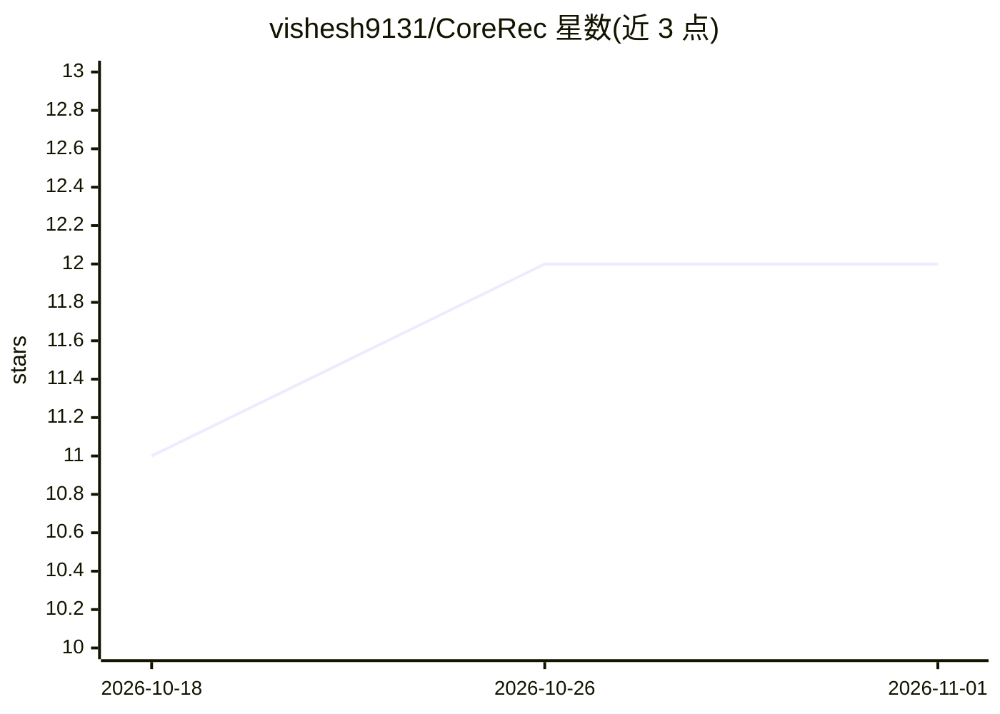

# vishesh9131/CoreRec

⭐ 12 · Python · MIT · 推送 2026-10-21 · [GitHub](https://github.com/vishesh9131/CoreRec) · [官网](https://corerec.online) · 个人维护

**PyTorch 推荐系统框架：16 个模型统一 API，一键训练到 HTTP 服务**

面向开发者的 Python 推荐系统库：16 个模型（ALS/EASE 等经典 CF、TwoTower、LightGCN、DCN/DeepFM、SASRec、生成式 HSTU、MultVAE、TF-IDF）共享 fit/predict/recommend/save/load 接口，支持检索→排序→重排多阶段流水线。corerec serve 命令可从 CSV 训练并起 HTTP 推荐端点，附带基准测试（与 implicit/LightFM 等对比）、ONNX 导出、A/B 测试与夜间再训练机制。要求 Python 3.10-3.13、PyTorch≥2.0；0.7.0 版本将模型数从 35 精简到 15+HSTU。

## 筛选速览

| 维度 | 判定 | 备注 |
|---|---|---|
| AI 角色 | `ai-native` | 本体是模型或模型工具 |
| 许可风险 | `permissive` | MIT |
| 部署形态 | `self-host` | docker 或自建部署 |
| 模型依赖 | — | README 未给出锁定关系 |
| 硬件要求 | — | 无带数字的原话,不猜 |
| 安装摩擦 | `low` | 无编译、无系统依赖或容器化 |
| 成熟度 | — | 结构信号不足 |

## 能力要点

- 16 个模型共享统一 fit/predict/recommend API
- corerec serve events.csv 一条命令从 CSV 训练到 HTTP 端点
- 支持 ONNX 导出（TwoTower/DCN/DeepFM/SASRec），服务端无需 Python
- 在线 CTR/漂移指标、A/B challenger 与条件再训练

## 适用场景

- 快速搭建从交互数据到推荐 API 的完整链路
- 在统一接口下切换对比 ALS、LightGCN、HSTU 等模型
- 把自定义 torch.nn.Module 包装为可训练/评估/部署的推荐器

## 场景标签

`推荐系统` · 领域:学习与行业

## 证据(README 行号)

> L63: CoreRec is a PyTorch library of recommendation models that share one API, from
> L67: - **Unified API**: every model shares `fit`, `predict`, `recommend`, `save`, `load`

## 星数曲线

2026-10-18 11 → 2026-11-01 12（+1）

---
*卡片 v1 · prompt 1.4 · 生成 2026-10-31 · 置信度 high · 依据 README sha `eedb4a6dfed8` · [字段定义](../../DATASET.md)*
