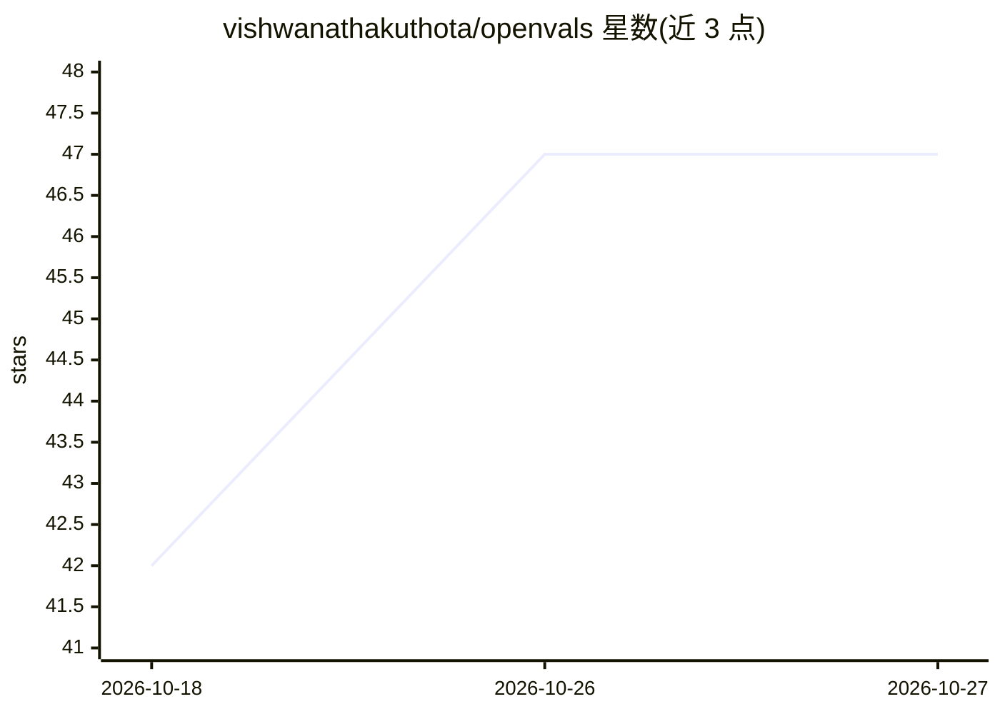

# vishwanathakuthota/openvals

⭐ 47 · Python · 推送 2026-08-13 · [GitHub](https://github.com/vishwanathakuthota/openvals) · [官网](https://openvalidations.com) · 个人维护

**企业级 LLM 评测与信任度量平台：多模型基准与幻觉检测**

面向企业的 AI 评测与信任平台，以 pip 安装的 Python CLI 提供：多维度评测（准确率、语义相似度、可靠性、一致性、延迟等）、事实性引擎（语义对齐、数值一致性、矛盾检测）、幻觉概率指数（HPI）、数据集校验 CLI（模式/质量/重复/缺失检测与数据集健康分），并综合为部署导向的 Decision Reliability Score（DRS）。支持 Ollama、vLLM 等私有化部署模型的并行多模型对比，内置金融、医疗、网络安全等基准数据集。许可证为 Dr.Pinnacle Community Edition License（DPCL-CE），云端版标注 coming soon。

## 筛选速览

| 维度 | 判定 | 备注 |
|---|---|---|
| AI 角色 | `ai-ecosystem` | LLM/agent 周边工具 |
| 许可风险 | `none` | — |
| 部署形态 | `library` | 以包/库形式分发 |
| 模型依赖 | local-ok | 支持本地模型 |
| 硬件要求 | — | 无带数字的原话,不猜 |
| 安装摩擦 | `low` | 无编译、无系统依赖或容器化 |
| 成熟度 | — | 结构信号不足 |

## 能力要点

- 多维度评测引擎与 Decision Reliability Score（DRS）部署信任分
- 事实性引擎与幻觉概率指数（HPI，四级风险）
- 数据集校验 CLI 与 Dataset Health Score
- 并行多模型基准执行（--parallel --max-workers）

## 适用场景

- 在部署前对比 GPT、Claude、Llama、Mistral 及私有模型
- 验证 Ollama/vLLM 自托管企业 AI 的可信度
- 评测前先校验基准数据集的质量
- 生成面向管理层的 AI 信任与就绪报告

## 场景标签

`模型评测` · 领域:评测与运维

## 证据(README 行号)

> L7: OpenVals is an enterprise-grade AI evaluation and trust platform designed to help organizations measure, compare, va
> L23: OpenVals is an AI Trust Intelligence Platform that helps enterprises evaluate, validate, benchmark, and govern AI s

## 星数曲线

2026-10-18 42 → 2026-10-27 47（+5）

---
*卡片 v1 · prompt 1.4 · 生成 2026-10-25 · 置信度 high · 依据 README sha `16649b33d252` · [字段定义](../../DATASET.md)*
