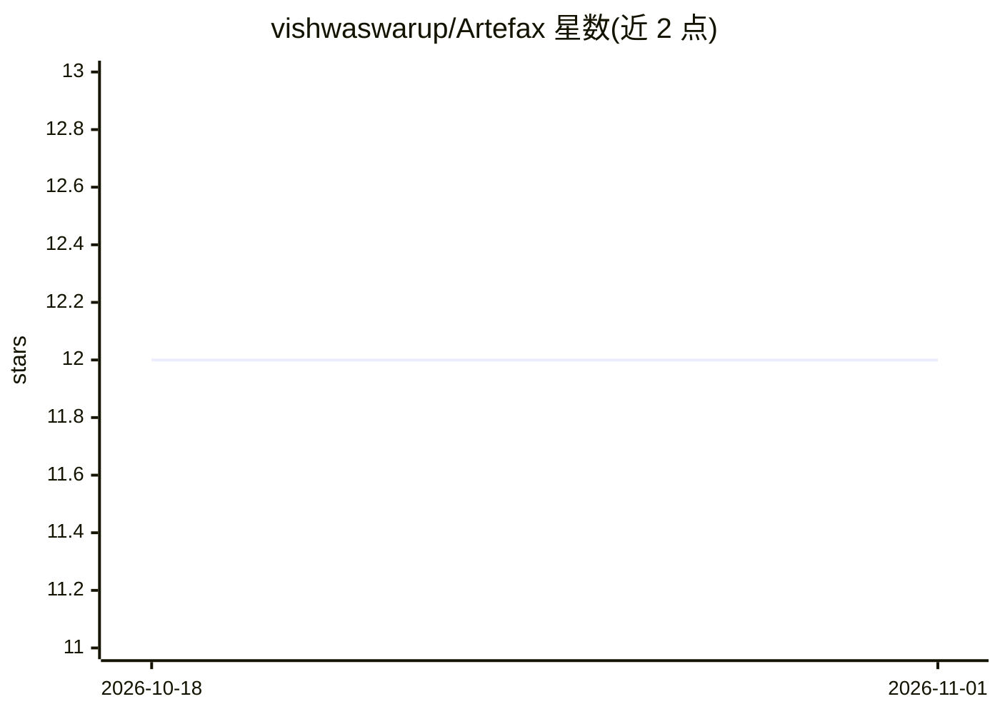

# vishwaswarup/Artefax

⭐ 12 · TypeScript · 推送 2026-09-15 · [GitHub](https://github.com/vishwaswarup/Artefax) · [官网](https://artefax.onrender.com/) · 个人维护

**解析一份文档后按受众生成多种格式内容的 AI 平台**

前后端分离的 GenAI 内容转换平台：上传 PDF 或粘贴文本后，调用 Gemini（默认 gemini-flash-lite-latest，结构化输出）一次性建立文档的规范化理解（标题/摘要/主题/实体/要点），再据此生成面向不同受众的输出——Executive Summary、LinkedIn Post、Advisory、Presentation——分别导出为 PDF/PPTX/TXT 文件，无需重复提示。后端 FastAPI + SQLite + 本地文件存储，前端 Next.js。自述为 hackathon MVP：无鉴权、容器化、RAG 问答，数据在部署重启后不持久。

## 筛选速览

| 维度 | 判定 | 备注 |
|---|---|---|
| AI 角色 | `ai-native` | 本体是模型或模型工具 |
| 许可风险 | `none` | — |
| 部署形态 | `library` | 以包/库形式分发 |
| 模型依赖 | — | README 未给出锁定关系 |
| 硬件要求 | — | 无带数字的原话,不猜 |
| 安装摩擦 | `low` | 无编译、无系统依赖或容器化 |
| 成熟度 | `idea` | |

## 能力要点

- Analyze Once / Transform Many：单次解析生成多种受众化输出
- 输出导出为真实 PDF/PPTX/TXT 文件
- 提供 Render Blueprint 一键部署前后端两个服务
- 默认 gemini-flash-lite-latest 以利用更高的免费层日配额

## 适用场景

- 把一份报告转换成管理层摘要、LinkedIn 帖子等多版本内容
- 基于同一份文档快速产出不同受众的演示文稿
- 在 Render 免费层快速部署一个文档内容生成演示

## 场景标签

`AI 写作` `文档解析` · 领域:内容生成

## 证据(README 行号)

> L3: An AI platform that ingests a source document, builds one canonical
> L34: MODEL_NAME=gemini-flash-lite-latest

## 星数曲线

2026-10-18 12 → 2026-11-01 12（+0）

---
*卡片 v1 · prompt 1.4 · 生成 2026-10-31 · 置信度 mid · 依据 README sha `162b2c43deee` · [字段定义](../../DATASET.md)*
