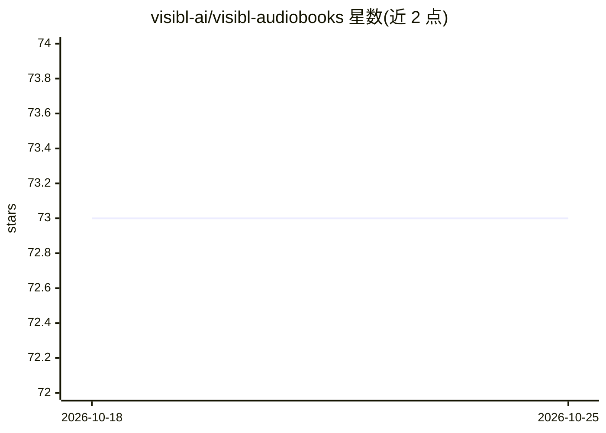

# visibl-ai/visibl-audiobooks

⭐ 73 · JavaScript · Apache-2.0 · 推送 2026-10-05 · [GitHub](https://github.com/visibl-ai/visibl-audiobooks) · [官网](https://visibl.ai) · 组织维护

**把小说自动转成图像小说的 iPhone 有声书播放器**

面向听众的 iPhone 有声书播放器：在收听时实时生成与旁白同步的视觉画面，把小说编译为图形小说。流水线为多阶段 LLM 处理：deepseek-v3 做实体抽取/属性元组/场景分解，gpt-5-mini 做别名消解与跨章状态推理，微调 gpt-4.1 生成实体视觉描述，再经 ControlNet 按用户短语（如 Wes Anderson、吉卜力）统一重绘全书风格并保持构图一致。免费提供 App Store 下载，仓库中未见流水线源码的本地安装方式。

## 筛选速览

| 维度 | 判定 | 备注 |
|---|---|---|
| AI 角色 | `ai-native` | 本体是模型或模型工具 |
| 许可风险 | `permissive` | Apache-2.0 |
| 部署形态 | `None` |  |
| 模型依赖 | — | README 未给出锁定关系 |
| 硬件要求 | — | 无带数字的原话,不猜 |
| 安装摩擦 | `low` | 无编译、无系统依赖或容器化 |
| 成熟度 | — | 结构信号不足 |

## 能力要点

- 实体抽取、别名消解、属性元组跟踪实现跨章节角色视觉一致性
- 章节分解为约 15 秒场景并与旁白时间戳同步
- ControlNet 按用户风格短语重绘全书画面
- 锁屏/正在播放封面展示当前场景的 Ambient 模式

## 适用场景

- 边听有声书边看自动生成的同步画面
- 用一句风格描述定制整本书的视觉风格
- 在锁屏一瞥即可确认当前说话角色与场景

## 场景标签

`图像生成` · 领域:内容生成

## 证据(README 行号)

> L24: visibl transforms any fiction novel into a personalized cinematic experience. It's a new kind of **audiobook player
> L101: Think of it as a compiler that takes a novel as input and outputs a Graphic Novel.
> L107: **TLDR; use RAG and graph data models to create detailed image prompts for a diffusion image model.**

## 星数曲线

2026-10-18 73 → 2026-10-25 73（+0）

---
*卡片 v1 · prompt 1.4 · 生成 2026-10-24 · 置信度 high · 依据 README sha `9e92a9892903` · [字段定义](../../DATASET.md)*
