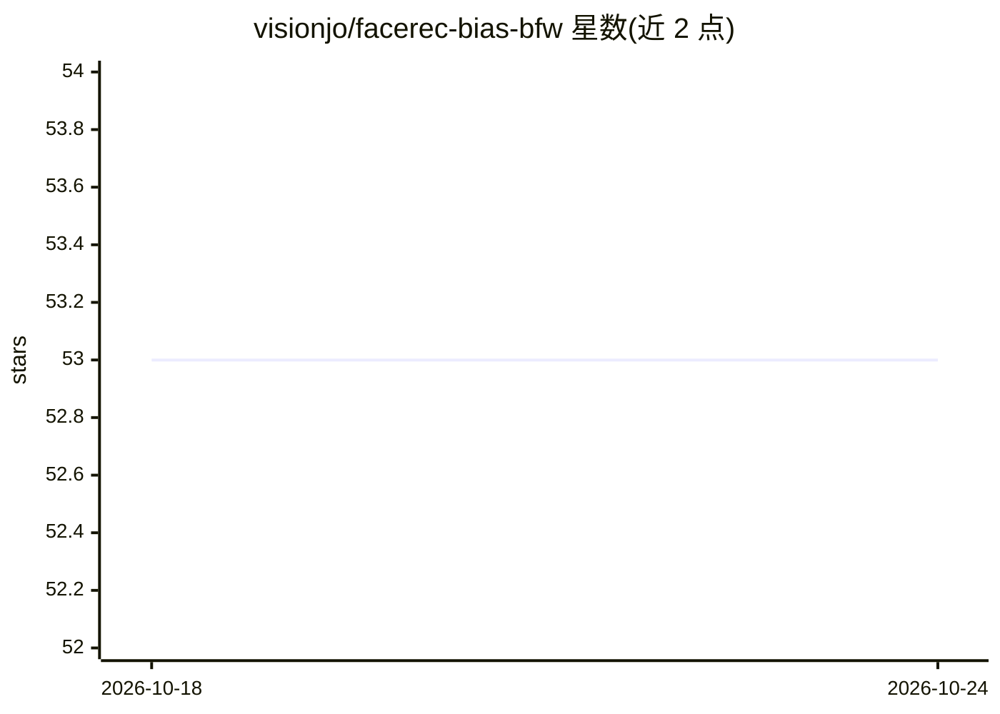

# visionjo/facerec-bias-bfw

⭐ 53 · Jupyter Notebook · BSD-3-Clause · 推送 2026-06-09 · [GitHub](https://github.com/visionjo/facerec-bias-bfw) · 组织维护

**人脸识别偏见研究数据集与实验复现代码（BFW）**

提供 Balanced Faces in the Wild (BFW) 数据集及配套 'facebias' 代码库：800 张人脸、100 个受试者、按 8 个人口统计学子组（亚裔/黑人/印度裔/白人 × 男/女）均衡划分，含身份标签与验证协议。代码支持复现两篇论文的实验，包括子组间相似度得分敏感性分析（SDM/DET 曲线）与全局阈值 vs 子组专属阈值的对比。数据经 Dropbox 与 IEEEDataPort 分发，代码以 BSD 3-clause 许可发布，仓库自述为进行中状态（含待办事项）。

## 筛选速览

| 维度 | 判定 | 备注 |
|---|---|---|
| AI 角色 | `ai-knowledge` | 知识聚合/清单类 |
| 许可风险 | `permissive` | BSD-3-Clause |
| 部署形态 | `None` |  |
| 模型依赖 | — | README 未给出锁定关系 |
| 硬件要求 | — | 无带数字的原话,不猜 |
| 安装摩擦 | `low` | 无编译、无系统依赖或容器化 |
| 成熟度 | `idea` | |

## 能力要点

- BFW 数据集：8 个子组均衡（每受试者 25 张、每子组 100 受试者）
- 信号检测模型与 DET 曲线分析子组得分敏感性
- 子组专属阈值与全局阈值的对比实验代码
- notebook 教程与可复现的论文实验模块

## 适用场景

- 我要评估人脸识别系统在不同族群/性别子组上的性能差异
- 复现论文中阈值策略对性能差距影响的实验
- 为公平性研究获取均衡的人脸验证基准数据

## 场景标签

`人脸识别` `模型评测` · 领域:评测与运维

## 证据(README 行号)

> L42: Intended to address bias in facial recognition, we built BFW as a labeled data resource for evaluating recognition 
> L49: This project investigates bias in automatic facial recognition (FR). Specifically, subjects are grouped into predef

## 星数曲线

2026-10-18 53 → 2026-10-24 53（+0）

---
*卡片 v1 · prompt 1.4 · 生成 2026-10-24 · 置信度 high · 依据 README sha `abd49de55782` · [字段定义](../../DATASET.md)*
