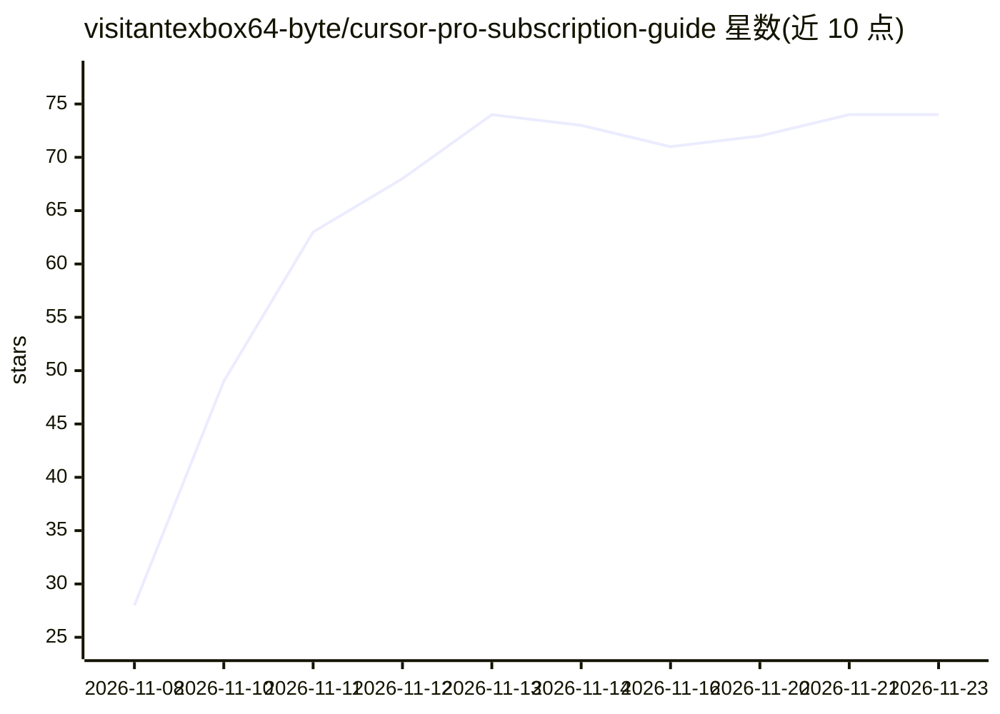

# visitantexbox64-byte/cursor-pro-subscription-guide

⭐ 74 · 推送 2026-11-03 · [GitHub](https://github.com/visitantexbox64-byte/cursor-pro-subscription-guide) · [官网](https://app.coregold.io/signup?invite_code=ADvlj9b) · 个人维护 · 中文 README

**教用户用 CoreGold 虚拟卡订阅 Cursor Pro/Business 的图文教程**

一份中文图文教程仓库，指导国内开发者通过 CoreGold 平台用 USDT 充值并生成欧美商业 Visa/Mastercard 虚拟卡，以完成 Cursor Pro（$20/月）或 Business（$40/月）的 Stripe 绑卡与扣费，规避国内双币信用卡被拒付的问题。内容包含拒付原因说明（Stripe 反欺诈、AVS 核验等）与三步实操流程。仓库本身不含可安装的软件，本质为指向 CoreGold 注册入口的推广文档。

## 筛选速览

| 维度 | 判定 | 备注 |
|---|---|---|
| AI 角色 | `ai-knowledge` | 知识聚合/清单类 |
| 许可风险 | `none` | — |
| 部署形态 | `None` |  |
| 模型依赖 | — | README 未给出锁定关系 |
| 硬件要求 | — | 无带数字的原话,不猜 |
| 安装摩擦 | `low` | 无编译、无系统依赖或容器化 |
| 成熟度 | — | 结构信号不足 |

## 能力要点

- 三步流程：USDT 充值→生成商业卡→Stripe 绑卡扣费
- 声称生成含 16 位卡号、CVV 与英文账单地址的虚拟卡
- 解释 Stripe 拒付的 AVS 失配、预授权等机制

## 适用场景

- 国内开发者订阅 Cursor Pro/Business 时参考绑卡流程
- 了解 Stripe 结算页拒付的常见原因

## 场景标签

`教程课程` · 领域:学习与行业

## 证据(README 行号)

> L2: ⚡ 2026 最新实测：手把手教你用 CoreGold 3 分钟开通 Cursor Pro / Business
> L27: ### 第一步：注入底池（1 分钟）

## 星数曲线

2026-11-08 28 → 2026-11-23 74（+46）

---
*卡片 v1 · prompt 1.4 · 生成 2026-11-18 · 置信度 high · 依据 README sha `93f6a685bc85` · [字段定义](../../DATASET.md)*
