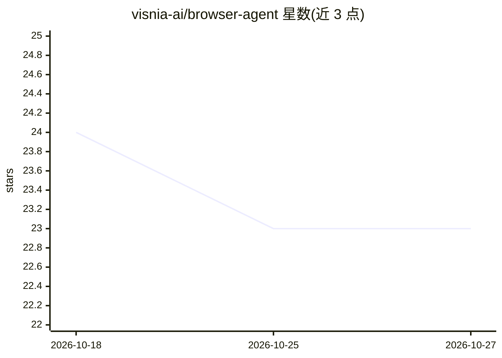

# visnia-ai/browser-agent

⭐ 23 · TypeScript · MIT · 推送 2026-08-28 · [GitHub](https://github.com/visnia-ai/browser-agent) · 组织维护

**浏览器自动化 Agent：让 LLM 按任务自动操作网页**

以 CLI 与 TypeScript/Python SDK 形式提供的浏览器自动化 agent：通过 YAML 或 SDK 定义任务与起始 URL，由配置的模型提供商（OpenAI、Anthropic、Google、Together、OpenRouter、Codex、vLLM 兼容端点）驱动浏览器执行任务并返回结果。SDK 安装时自动下载对应 CLI、校验 checksum 并流式返回进度事件。登录凭据通过加密方式在 YAML 中提供，凭据输入由脚本代填以避免暴露给模型提供商。运行需 Node.js v20+ 或 Python 3.11+、Chrome/Chromium 及对应 API key。

## 筛选速览

| 维度 | 判定 | 备注 |
|---|---|---|
| AI 角色 | `ai-native` | 本体是模型或模型工具 |
| 许可风险 | `permissive` | MIT |
| 部署形态 | `library` | 以包/库形式分发 |
| 模型依赖 | local-ok | 支持本地模型 |
| 硬件要求 | — | 无带数字的原话,不猜 |
| 安装摩擦 | `low` | 无编译、无系统依赖或容器化 |
| 成熟度 | — | 结构信号不足 |

## 能力要点

- YAML 任务配置 + CLI 运行的浏览器自动化
- 支持 OpenAI/Anthropic/Google/Together/OpenRouter/Codex/vLLM 等提供商
- TypeScript 与 Python SDK 自动下载 CLI、校验 checksum、流式进度事件
- 登录凭据加密存储且由脚本代填，不暴露给模型提供商

## 适用场景

- 用自然语言任务描述自动化网页操作
- 需要登录的网站上的自动化流程
- 通过 SDK 在程序中集成浏览器自动化任务

## 场景标签

 · 领域:浏览器自动化/Agent

## 证据(README 行号)

> L3: A powerful & efficient browser agent that automates any task on the web.
> L103: Browser Agent provides TypeScript and Python SDKs for running browser automation tasks. Both SDKs install the matc

## 星数曲线

2026-10-18 24 → 2026-10-27 23（-1）

---
*卡片 v1 · prompt 1.4 · 生成 2026-10-27 · 置信度 high · 依据 README sha `daf3a5cf4e4f` · [字段定义](../../DATASET.md)*
