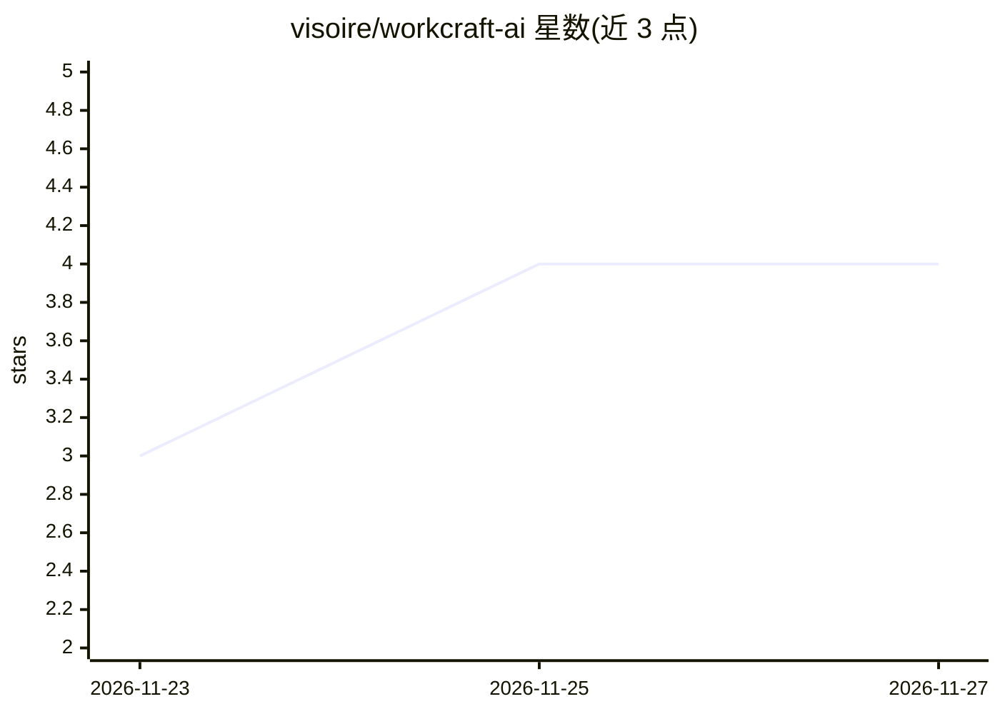

# visoire/workcraft-ai

⭐ 4 · Rust · Apache-2.0 · 推送 2026-11-06 · [GitHub](https://github.com/visoire/workcraft-ai) · [官网](https://github.com/visoire/workcraft-ai#readme) · 个人维护

**本地优先的 AI 聊天与多 agent 桌面应用，可操作文件与 Craft 应用**

用 Rust 编写的桌面聊天应用（egui），同时提供 CLI 与 MCP server 三种入口。可读写指定文件夹内的文件、调用 MCP 工具、驱动本机安装的 17 个 Craft 应用；支持单助手与团队模式（leader 规划任务图、专家并行执行并互审）。模型经 Ollama 本地运行或使用用户自己的 API key，本身不内置模型。状态为 alpha，无稳定版，二进制未签名，密钥明文存于本地配置文件；仅 Windows 11 为已验证平台。

## 筛选速览

| 维度 | 判定 | 备注 |
|---|---|---|
| AI 角色 | `ai-native` | 本体是模型或模型工具 |
| 许可风险 | `permissive` | Apache-2.0 |
| 部署形态 | `desktop` | 安装包/桌面程序 |
| 模型依赖 | local-ok | 支持本地模型 |
| 硬件要求 | — | 无带数字的原话,不猜 |
| 安装摩擦 | `medium` | 含编译或系统依赖之一 |
| 成熟度 | `idea` | |

## 能力要点

- 桌面应用、CLI 与 MCP server 共用同一命令总线
- 团队模式：任务图规划、并行执行、结果互审与共享记忆板
- 接入 17 个 Craft 应用与任意 MCP server，工具调用需 Allow/Deny 控制
- 本地会话为纯文件/JSONL，无账号、无遥测

## 适用场景

- 让助手读写本地文件夹并处理文件任务
- 通过多个 agent 并行完成图像、文档、视频等创作流程
- 用 MCP server 让 Claude Code、Cursor 等其他 agent 驱动本应用

## 场景标签

`多智能体` `聊天机器人` · 领域:Agent 开发

## 证据(README 行号)

> L16: WorkCraft AI is a desktop chat for talking to a model that can actually do things: read and write files in a folder
> L19: plans, works in parallel and reviews each other. Models run locally with Ollama or through your own API keys.
> L40: |A client for models you choose (Ollama, LM Studio, Claude, ChatGPT, Gemini, DeepSeek, Grok, GLM, Mistral, Groq, Op

## 星数曲线

2026-11-23 3 → 2026-11-27 4（+1）

---
*卡片 v1 · prompt 1.4 · 生成 2026-11-23 · 置信度 high · 依据 README sha `8f3f079db890` · [字段定义](../../DATASET.md)*
