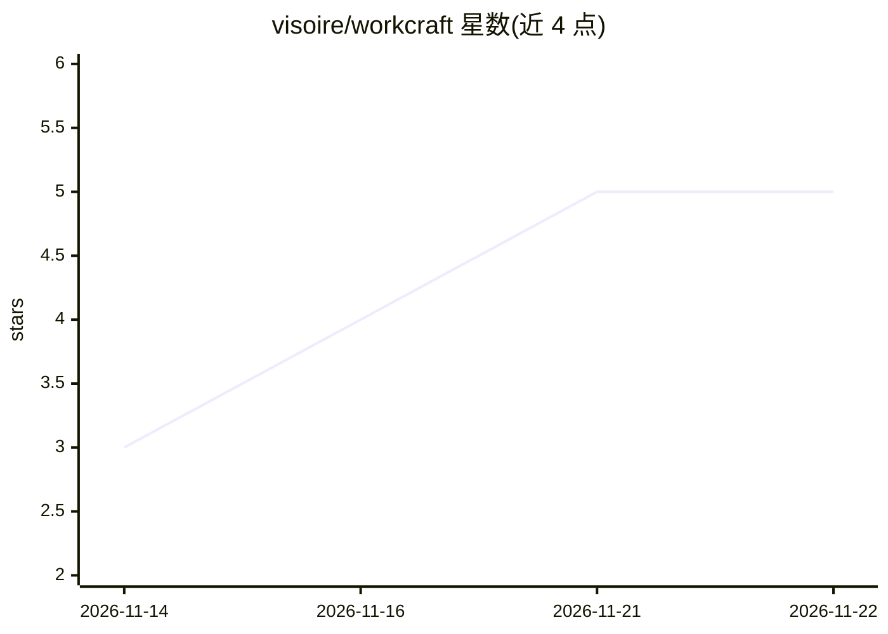

# visoire/workcraft

⭐ 5 · TypeScript · NOASSERTION · 推送 2026-11-21 · [GitHub](https://github.com/visoire/workcraft) · [官网](https://workcraft.cc/) · 组织维护

**本地优先的统一工作区，内置可私有的 AI 助手**

WorkCraft 是一个本地优先的单窗口工作区，整合文档、表格、演示、PDF 及照片、视频、音频、3D、CAD 等 44 个开源应用（WebAssembly 运行），文件保存在用户自有文件夹，支持 Windows/macOS/Linux/iPadOS。内置 AI 助手可读取和编辑各应用中的文件，通过 MCP 调用工具，每步操作可检查和撤销；支持 Ollama 本地模型或自备 API key，可切换单人/团队多 agent 模式，并可作为 MCP 服务端供 Cursor、Claude Code 等客户端使用。当前为 alpha 阶段（0.1.0-alpha.5），无稳定版，设置与数据格式可能在版本间变动。

## 筛选速览

| 维度 | 判定 | 备注 |
|---|---|---|
| AI 角色 | `ai-enhanced` | 去掉 AI 部分产品仍成立 |
| 许可风险 | `permissive` | NOASSERTION |
| 部署形态 | `desktop` | 安装包/桌面程序 |
| 模型依赖 | local-ok | 支持本地模型 |
| 硬件要求 | — | 无带数字的原话,不猜 |
| 安装摩擦 | `low` | 无编译、无系统依赖或容器化 |
| 成熟度 | `idea` | |

## 能力要点

- 44 个开源应用集成于同一单窗口工作区，支持分屏与面板布局
- AI 助手经 MCP 读写文件，每步可检查、可撤销
- 支持 Ollama 本地模型与 12+ 云端服务商自备 key，Local-only 模式屏蔽所有云服务商
- 双 MCP 方向：既是 MCP 服务端也是客户端，支持 Team 模式多 agent 协作

## 适用场景

- 在本地一个窗口里完成文档、表格、演示、PDF 混合项目
- 不希望文件上传云端、用本地模型驱动的 AI 助手处理文件
- 让多个 AI agent 分工协作处理项目任务并逐步审批
- 用 Cursor、Claude Code 等 MCP 客户端操作本地项目文件

## 场景标签

`AI 助手` `多智能体` · 领域:Agent 开发

## 证据(README 行号)

> L31: Developers have long had editors where code, a terminal and the file tree sit side by side in one window. Everyone 
> L38: |**AI built in**|An assistant that reads and edits your files in every app of the workspace (it has a specialist fo

## 星数曲线

2026-11-14 3 → 2026-11-22 5（+2）

---
*卡片 v1 · prompt 1.4 · 生成 2026-11-21 · 置信度 high · 依据 README sha `d6da411a8ab8` · [字段定义](../../DATASET.md)*
