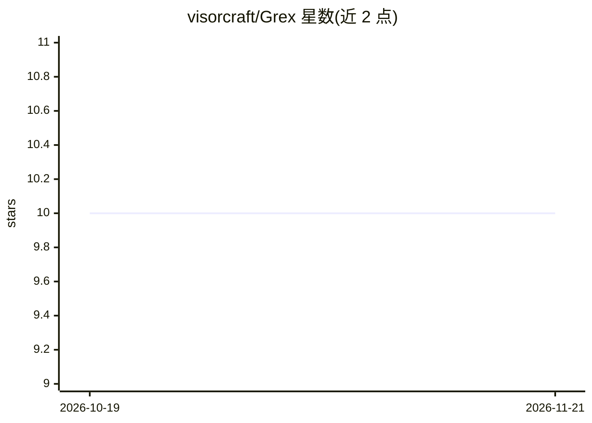

# visorcraft/Grex

⭐ 10 · C# · GPL-3.0 · 推送 2026-07-28 · [GitHub](https://github.com/visorcraft/Grex) · [官网](https://www.visorcraft.com) · 个人维护

**Windows 多标签 grep 图形工具，支持本地/UNC/WSL/Docker 搜索**

基于 WinUI 3 与 .NET 8 的 Windows 桌面文本搜索工具，保留 grep 的匹配语义并增加多标签、结果预览、过滤导出历史与命名配置等功能。搜索目标覆盖本地磁盘、UNC 共享、WSL 发行版（经 wsl.exe 调用 Linux 侧命令）与运行中的 Docker 容器；支持确认式批量替换（无撤销，WSL 用 sed -i），并提供 grex-cli 命令行伴随工具。可选接入用户自行配置的 OpenAI 兼容端点进行 AI 聊天，不自动发送文件内容；API key 以明文存储。提供安装包、便携 zip 与源码构建，仅支持 Windows x64。

## 筛选速览

| 维度 | 判定 | 备注 |
|---|---|---|
| AI 角色 | `ai-enhanced` | 去掉 AI 部分产品仍成立 |
| 许可风险 | `viral` | GPL-3.0 |
| 部署形态 | `desktop` | 安装包/桌面程序 |
| 模型依赖 | — | README 未给出锁定关系 |
| 硬件要求 | — | 无带数字的原话,不猜 |
| 安装摩擦 | `medium` | 含编译或系统依赖之一 |
| 成熟度 | — | 结构信号不足 |

## 能力要点

- 本地、UNC、WSL、Docker 四类搜索目标
- 可视化 Regex Builder（预设、实时匹配、语法分解）
- 确认式批量替换，支持 Windows/UNC/WSL 路径
- 附带 grex-cli 命令行工具，退出码与 grep 一致

## 适用场景

- 在 Windows 图形界面中跨本地与远程共享执行正则搜索
- 在 WSL 发行版与 Docker 容器内查找文件内容
- 对搜索结果执行批量替换前先预览确认

## 场景标签

`聊天机器人` · 领域:对话与助手

## 证据(README 行号)

> L5:  A modern, tabbed grep experience for Windows.
> L36: - Optional AI chat through a user-configured OpenAI-compatible endpoint
> L102: Grex can send a chat request to an OpenAI-compatible endpoint that you configure. It sends the current path, query

## 星数曲线

2026-10-19 10 → 2026-11-21 10（+0）

---
*卡片 v1 · prompt 1.4 · 生成 2026-11-19 · 置信度 high · 依据 README sha `4f675b7fdad9` · [字段定义](../../DATASET.md)*
