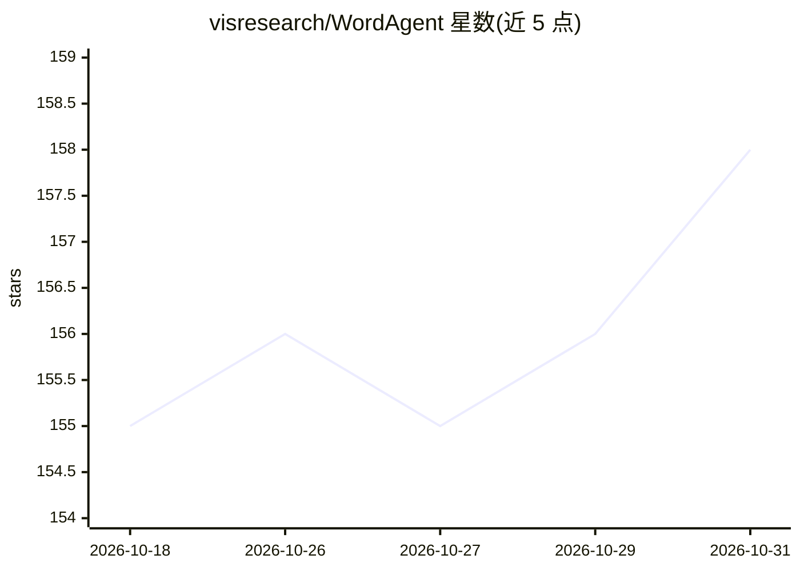

# visresearch/WordAgent

⭐ 158 · Python · Apache-2.0 · 推送 2026-10-29 · [GitHub](https://github.com/visresearch/WordAgent) · [官网](https://visresearch.github.io/WordAgent/) · 组织维护 · 中文 README

**面向 WPS 与 Word 的 AI 智能体写作辅助加载项系统**

通过 WPS 与 Microsoft Word 加载项接入的 AI 辅助写作系统：前端加载项把用户问题与所选段落转为 JSON 发往后端，后端以 ReAct 智能体循环调用 search/read/delete/generate/edit 等文档工具，完成内容生成、结构优化与修改，结果以 Word 原生修订形式呈现，并保留标题/加粗/缩进等样式。支持 MCP Server 与 Skill 两类扩展工具、上下文压缩与长短期记忆。用户自带 LLM API key，已测试 Qwen、GLM、GPT、DeepSeek、Claude 等多家模型；支持 Windows/Linux/macOS，提供打包发布文件与源码构建流程。限制：公式可读不可生成，尚不支持 localhost 之外的局域网与云端部署。

## 筛选速览

| 维度 | 判定 | 备注 |
|---|---|---|
| AI 角色 | `ai-native` | 本体是模型或模型工具 |
| 许可风险 | `permissive` | Apache-2.0 |
| 部署形态 | `desktop` | 安装包/桌面程序 |
| 模型依赖 | — | README 未给出锁定关系 |
| 硬件要求 | — | 无带数字的原话,不猜 |
| 安装摩擦 | `low` | 无编译、无系统依赖或容器化 |
| 成熟度 | — | 结构信号不足 |

## 能力要点

- ReAct 智能体循环 + 文档工具（search/read/delete/generate/edit_document）操作 Word 段落
- 内容与样式分离的结构化文档数据模型，生成结果保留标题/加粗/字体/行距等样式
- MCP Server 与 Skill 两类可插拔扩展工具
- 用户自带 API key，支持多家主流 LLM 提供商；跨 Windows/Linux/macOS 并提供打包安装包

## 适用场景

- 在 WPS 或 Word 中用自然语言让 AI 修改、生成文章内容并保留格式
- 通过 MCP 接入高德天气等第三方 API，自动取数、画图并成文
- 以 Skill 包复用领域写作与处理流程

## 场景标签

`AI 助手` `AI 写作` · 领域:对话与助手

## 证据(README 行号)

> L18: This project is an AI-assisted writing system based on an agent workflow: **WenCe AI**. After installing the **add-
> L35: For example, in WPS **Single Agent** mode, a user can enter: "Revise my internship objectives into five points." Th
> L77: In the backend Single Agent architecture, the system uses a standard ReAct agent loop. In each loop, the agent reas

## 星数曲线

2026-10-18 155 → 2026-10-31 158（+3）

---
*卡片 v1 · prompt 1.4 · 生成 2026-10-23 · 置信度 mid · 依据 README sha `9c5ae896db62` · [字段定义](../../DATASET.md)*
