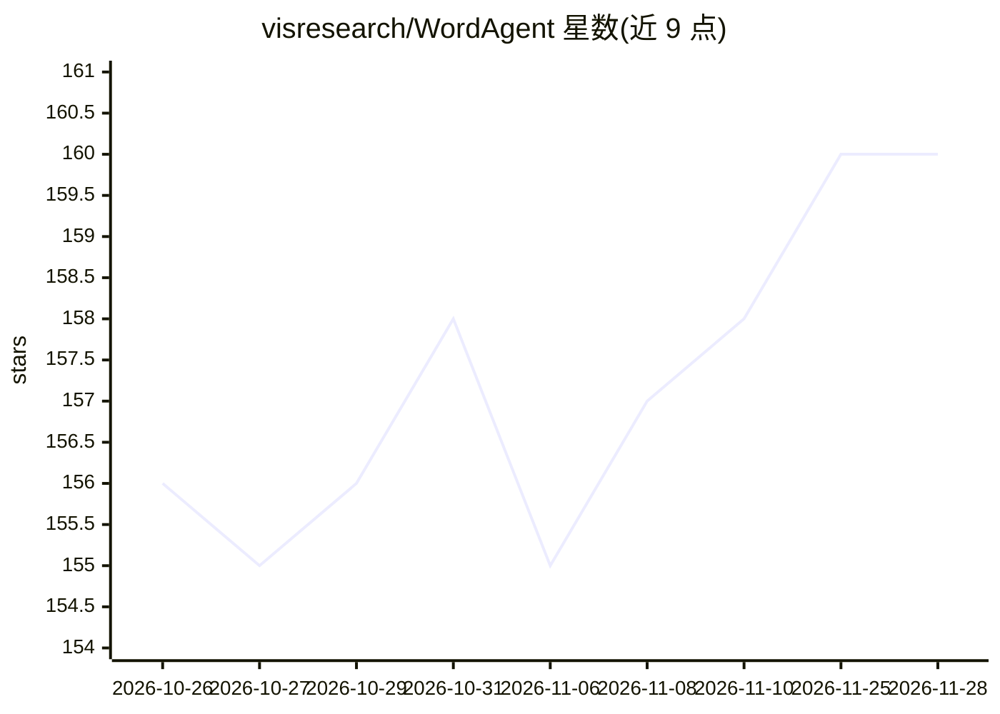

# visresearch/WordAgent

⭐ 160 · Python · Apache-2.0 · 推送 2026-11-27 · [GitHub](https://github.com/visresearch/WordAgent) · [官网](https://visresearch.github.io/WordAgent/) · 组织维护 · 中文 README

**通过 WPS/Word 加载项实现 AI 智能体辅助写作**

基于 agent 工作流（WenCe AI）的写作辅助系统，在 WPS 或 Microsoft Word 中安装加载项后，用户以自然语言交互获得写作建议、内容生成与结构优化。后端为 Python/FastAPI/LangChain 的 ReAct 单 Agent 循环，提供 search/read/generate/delete/edit_document 等文档工具，生成结果包含标题、字体、缩进等样式信息并通过 Word 修订标记呈现。支持 MCP Server 与 Skill 两种扩展方式，LLM API key 由用户提供。WPS 加载项在新版 Windows 上可能冻结，需切换多组件模式。

## 筛选速览

| 维度 | 判定 | 备注 |
|---|---|---|
| AI 角色 | `ai-native` | 本体是模型或模型工具 |
| 许可风险 | `permissive` | Apache-2.0 |
| 部署形态 | `desktop` | 安装包/桌面程序 |
| 模型依赖 | locked-api |  |
| 硬件要求 | — | 无带数字的原话,不猜 |
| 安装摩擦 | `low` | 无编译、无系统依赖或容器化 |
| 成熟度 | — | 结构信号不足 |

## 能力要点

- ReAct 单 Agent 循环调用文档工具完成定位、读取、编辑、生成
- 生成结构化文档：内容与样式分离，保留标题/字体/缩进等 Word 样式
- 支持 MCP Server 与 Skill 两种可插拔扩展机制
- LLM 供应商由用户自选，支持多数主流 API

## 适用场景

- 在 WPS/Word 中用自然语言让 Agent 改写、生成、优化文章结构
- 让 Agent 自主联网搜集信息并生成符合文档格式的稿件
- 通过 MCP 接入第三方 API（如天气查询+图表生成）写作

## 场景标签

`AI 写作` · 领域:内容生成

## 证据(README 行号)

> L18: This project is an AI-assisted writing system based on an agent workflow: **WenCe AI**. After installing the **add-
> L27: 4. **Open and flexible, with custom API or local service support**: the LLM API key used by this project is provide
> L90: - node v22.12.0

## 星数曲线

2026-10-26 156 → 2026-11-28 160（+4）

---
*卡片 v1 · prompt 1.4 · 生成 2026-11-28 · 置信度 high · 依据 README sha `85090b25f882` · [字段定义](../../DATASET.md)*
