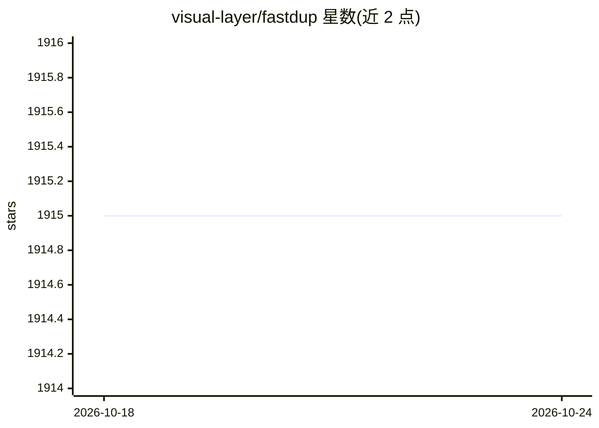

# visual-layer/fastdup

⭐ 1,915 · Python · NOASSERTION · 推送 2026-08-23 · [GitHub](https://github.com/visual-layer/fastdup) · [官网](https://docs.visual-layer.com/fastdup_docs_old/First%20Steps/getting-started) · 组织维护

**图像/视频数据集质量分析工具：找重复、异常与错标**

fastdup 是面向图像与视频数据集的分析工具，识别重复/近重复、异常值、错标、损坏与低质量图像，并支持图像相似度搜索；提供 duplicates/outliers 等静态图库可视化与 remove_duplicates 一键去重（可 dry_run 预览）。采用 C++ 引擎，可在单台 CPU 机器上处理大规模数据集（README 称 4 亿张），支持 macOS/Linux/Windows 与有标注/无标注数据。以 Python 包经 pip 安装，由 Visual Layer（XGBoost/Turi Create 作者创立）维护，另提供商业云服务；许可为 CC BY-NC-ND 4.0。内置实验性 Sentry 崩溃上报，可通过环境变量退出。

## 筛选速览

| 维度 | 判定 | 备注 |
|---|---|---|
| AI 角色 | `ai-native` | 本体是模型或模型工具 |
| 许可风险 | `none` | NOASSERTION |
| 部署形态 | `library` | 以包/库形式分发 |
| 模型依赖 | — | README 未给出锁定关系 |
| 硬件要求 | — | 无带数字的原话,不猜 |
| 安装摩擦 | `low` | 无编译、无系统依赖或容器化 |
| 成熟度 | — | 结构信号不足 |

## 能力要点

- 识别重复/近重复、异常、错标、损坏与低质量图像
- remove_duplicates 单调用去重，支持 dry_run 预览与相似度阈值调整
- C++ 引擎，单台 CPU 机器可处理大规模数据集，本地或自有云运行
- 支持 TIMM/ONNX（如 DINOv2）提取嵌入向量，CPU 与 GPU 均可运行

## 适用场景

- 训练前清洗图像数据集，找出重复与错标样本
- 对大规模图像库做相似度搜索与去重
- 在 Colab/Kaggle 上分析 Hugging Face 数据集质量

## 场景标签

 · 领域:计算机视觉/数据工程

## 证据(README 行号)

> L79: + **Quality**: High-quality analysis to identify duplicates/near-duplicates, outliers, mislabels, broken images, an
> L210:  🧠 TIMM Embeddings: Compute dataset embeddings using TIMM (PyTorch Image Models) and run fastdup over the them to 

## 星数曲线

2026-10-18 1,915 → 2026-10-24 1,915（+0）

---
*卡片 v1 · prompt 1.4 · 生成 2026-10-21 · 置信度 high · 依据 README sha `20dd2247593b` · [字段定义](../../DATASET.md)*
