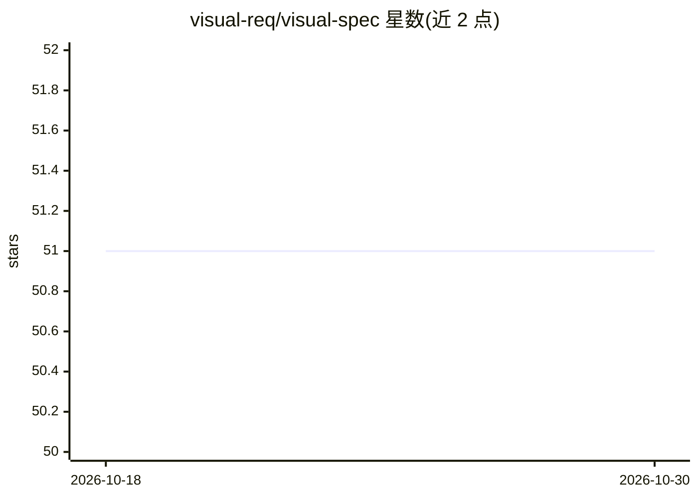

# visual-req/visual-spec

⭐ 51 · HTML · MIT · 推送 2026-10-05 · [GitHub](https://github.com/visual-req/visual-spec) · 组织维护 · 中文 README

**把一句话需求转成可运行原型与可追溯规格的 AI 编辑器技能**

以 npx 安装到 AI 编辑器（Trae / Claude Code / Cursor / GitHub Copilot 等）的 Skill，通过 /vspec:* 分阶段命令工作流执行：从一句话业务需求生成角色、场景、流程等结构化规格，产出数据模型与可运行 Web 原型（含角色看板与场景评审页），再生成 RBAC/校验等详设规格、验收用例 JSON、单元/集成测试用例与 Playwright 脚本，并可生成前后端集成代码输入与排期计划。面向产品/BA、工程师与 QA。

## 筛选速览

| 维度 | 判定 | 备注 |
|---|---|---|
| AI 角色 | `ai-native` | 本体是模型或模型工具 |
| 许可风险 | `permissive` | MIT |
| 部署形态 | `library` | 以包/库形式分发 |
| 模型依赖 | — | README 未给出锁定关系 |
| 硬件要求 | — | 无带数字的原话,不猜 |
| 安装摩擦 | `low` | 无编译、无系统依赖或容器化 |
| 成熟度 | — | 结构信号不足 |

## 能力要点

- 分阶段 /vspec:* 命令工作流：规格→原型→详设→测试→排期
- /vspec:verify 生成对齐 /scheme.yaml 的可运行 Web 原型与角色看板
- 生成验收用例 JSON、单元/集成测试用例及 Playwright 自动化脚本
- 支持遗留系统升级（upgrade）与需求变更同步（refine）

## 适用场景

- 把模糊想法快速变成可评审的场景与可运行原型
- 为每个功能生成权限/校验/日志等实现级详设规格
- 把关键场景转成可执行的验收用例与自动化测试

## 场景标签

`代码生成` · 领域:编码与开发

## 证据(README 行号)

> L44: npx skills add visual-req/visual-spec --skill visual-spec
> L73: - Prototype generation (high-frequency): `/vspec:verify` generates a runnable Web prototype aligned with `/scheme.y

## 星数曲线

2026-10-18 51 → 2026-10-30 51（+0）

---
*卡片 v1 · prompt 1.4 · 生成 2026-10-24 · 置信度 high · 依据 README sha `46a2d16d2aaa` · [字段定义](../../DATASET.md)*
