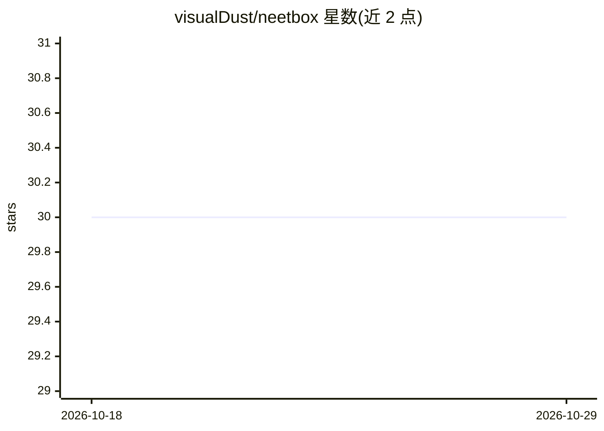

# visualDust/neetbox

⭐ 30 · Python · MIT · 推送 2026-08-04 · [GitHub](https://github.com/visualDust/neetbox) · [官网](https://neetbox.550w.host) · 个人维护

**机器学习实验的可视化与工具库**

Python 库 neetbox，面向机器学习实验过程提供可视化与工具功能（仓库描述标注 Beta）。通过 pip/PyPI 安装，提供文档站点 neetbox.550w.host；开发方式为 conda 创建 Python 3.12 虚拟环境后从源码构建可编辑版本。README 可见部分以安装说明、截图与贡献者为主，功能细节需查阅文档站点。使用 PyDocuSaurus 生成 API 参考。

## 筛选速览

| 维度 | 判定 | 备注 |
|---|---|---|
| AI 角色 | `ai-ecosystem` | LLM/agent 周边工具 |
| 许可风险 | `permissive` | MIT |
| 部署形态 | `library` | 以包/库形式分发 |
| 模型依赖 | — | README 未给出锁定关系 |
| 硬件要求 | — | 无带数字的原话,不猜 |
| 安装摩擦 | `low` | 无编译、无系统依赖或容器化 |
| 成熟度 | — | 结构信号不足 |

## 能力要点

- pip install neetbox 一行安装，发布于 PyPI
- 提供 conda + 源码构建的开发流程
- 配套文档站点 neetbox.550w.host

## 适用场景

- 在深度学习实验过程中记录并可视化训练状态
- 作为实验代码片段与工作流管理工具引入项目

## 场景标签

`MLOps` · 领域:训练与推理

## 证据(README 行号)

> L1: wakatime pytest GitHub Workflow Status (with event) PyPI - Version

## 星数曲线

2026-10-18 30 → 2026-10-29 30（+0）

---
*卡片 v1 · prompt 1.4 · 生成 2026-10-26 · 置信度 mid · 依据 README sha `31a651b59282` · [字段定义](../../DATASET.md)*
